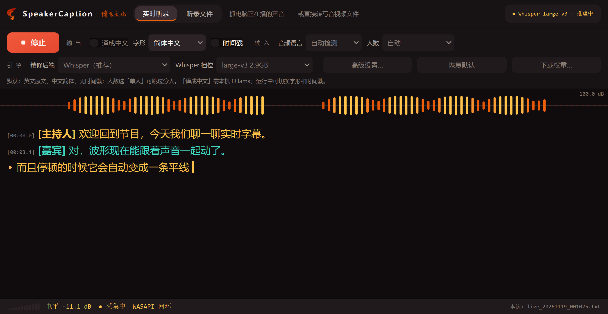
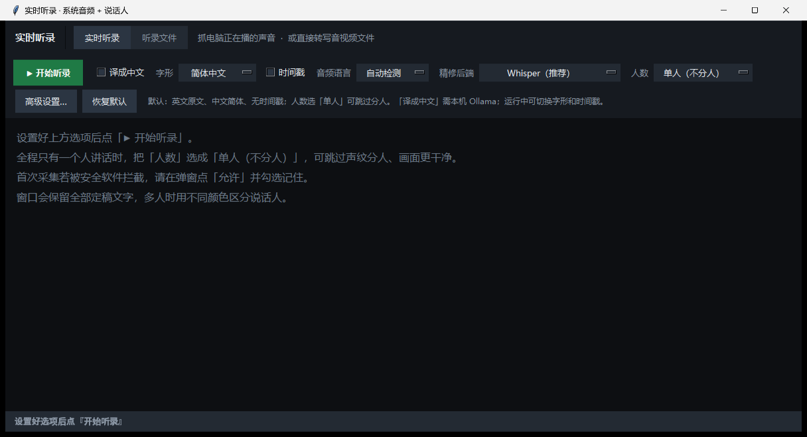

# SpeakerCaption

[简体中文](README.md) · **English**

**Offline transcription of audio/video files + live captioning of system audio, both with speaker diarization.**



- `diarize.py` — give it a two-person podcast or a multi-speaker interview, get back *who said what, when*.
- `live.py` — **captures whatever the computer is playing right now** (online meetings, live podcasts, streams) and produces subtitles with speaker labels as the audio arrives.

Both write `txt / srt / json / rttm`. The whole pipeline runs locally: no audio is uploaded and no proprietary service is required.

**Requirements**: Python 3.10+ · Windows / macOS / Linux · core diarization is CPU-only (~35 MB of models) · an NVIDIA GPU speeds up the end-of-utterance refinement pass. The code is Apache-2.0; model weights keep their own upstream licenses.

```
audio -> pyannote segmentation -> CAM++ embeddings -> clustering -> (speaker, start, end)
                                                          |
                                                          v
                                              per-segment ASR -> speaker-labelled transcript
```

## Features

- **Speaker diarization**: pyannote segmentation 3.0 + 3D-Speaker CAM++ via sherpa-onnx.
  Pure ONNX Runtime, **runs on CPU**, measured at 15–28x real time.
- **Pluggable ASR**: `whisper` (faster-whisper, default, cross-platform) / `confucius`
  (optional, talks to a Confucius4-R2T2 Chinese backend you deploy yourself) / `none`
  (segments only, no text).
- **Any input container**: wav/flac/ogg read directly; mp3/m4a/mp4 etc. are decoded via ffmpeg.
- **Cross-platform**: one set of commands on Windows / macOS / Linux. Offline mode needs no
  audio device at all; live mode works out of the box on Windows and needs a virtual loopback
  device elsewhere. No dependency on a local port 7861, and no compiled proprietary modules.
- **One document per session**: filenames carry a timestamp (e.g. `live_20261118_233520.txt`),
  so starting a second session never overwrites the first — and you do not get one file per sentence.
- **Named speakers**: `--speaker-names "1=Host,2=Guest"`.
- **Text is timestamp-free by default** (`--timestamps` to enable); srt / json / rttm always
  carry precise timings.
- **Control over script and translation**: language is auto-detected by default (English stays
  English), Chinese is normalised to **Simplified**; translating into Chinese, emitting
  Traditional characters, or leaving text untouched are all options in the live window.
- **Live window with an options panel**: translation / script / timestamps / language / backend /
  speaker count / advanced parameters, saved automatically to `settings.json`.
- **The waveform follows the real audio**: the flame-coloured bars in the middle of the window
  are not a decorative animation — each bar is the min/max of the captured PCM samples. Silence
  flattens to a line; file mode shows the whole file's waveform plus a transcription playhead.

> How the two modes differ: **offline `diarize.py`** clusters globally over the entire recording,
> giving the most stable labels and allowing review afterwards. **Live `live.py`** assigns a label
> the moment VAD closes an utterance and never revises it, optimising for low latency. Both share
> the same CAM++ model and the same `rttm/json` output schema, so results can feed into each other.

### How this differs from similar projects

"Whisper + diarization" is a crowded space, but most solutions (whisperX, whisper-diarization,
aTrain) require **a HuggingFace token + accepting a gated-model agreement + the whole
torch/NeMo stack**, while the live side is covered by WhisperLiveKit / meetily. This project sits
in the gap between them:

**No HF token, no GPU, no torch, 35 MB of models, a one-shot `pip install` CLI** that emits all
four `txt / srt / json / rttm` files with speaker labels in a single run, with ASR freely
swappable (including a Chinese hot-word backend). The entire stack is Apache-2.0 / MIT, with no
AGPL viral licensing.

The full competitor list, star/license snapshot, search methodology and risk notes are in
[docs/RELATED_WORK.md](docs/RELATED_WORK.md) *(Chinese)*.

## What's in this repository

This repository contains **code and documentation only** — no model weights, no virtual
environment, no runtime artifacts:

| In the repository | You provide |
|---|---|
| All source in `src/`, CLI entry points `live.py` / `diarize.py` | Python dependencies: `pip install -r requirements.txt` |
| Tests in `tests/`, model and diagnostic scripts in `scripts/` | **Model weights**: 35 MB – 2.88 GB, see below |
| Docs and UI screenshots in `docs/`, license and third-party notices | Confucius4-R2T2 backend (optional, self-deployed) |
| Windows launchers, dependency lists, ignore rules | `settings.json` (local config, created on first run) |

`.venv/`, `models/`, `out/`, `live_out/`, `settings.json`, test audio and output files are all
excluded by [.gitignore](.gitignore) and **never appear in any commit**. A fresh clone therefore
has to download models before it runs — this is deliberate: weights are large and each has its
own upstream license, so they do not belong in Git. See "License & compliance" below and
[THIRD_PARTY_NOTICES.md](THIRD_PARTY_NOTICES.md) *(bilingual)*.

## Quick start

Python 3.10+ is required:

```bash
git clone https://github.com/LouisChenParfait/SpeakerCaption.git
cd SpeakerCaption

python -m venv .venv
# Windows: .venv\Scripts\activate     macOS/Linux: source .venv/bin/activate
pip install -r requirements.txt

# 1) Required: diarization models (~35 MB)
python scripts/download_models.py
# 2) For live mode (live.py): also VAD + streaming ASR (~232 MB)
python scripts/download_models.py --with-live
# 3) To get text: Whisper weights (2.88 GB; smaller tiers below)
python scripts/download_models.py --with-whisper large-v3

python scripts/check_env.py                  # optional: environment check
python diarize.py --help
python live.py --help
```

On Windows, once `.venv` is ready you can use the launchers instead:
`run.bat <audio> [args]` or `run_live.bat [args]`.

> If downloads are slow or pip returns 403, try another PyPI mirror, e.g.
> `pip install -r requirements.txt -i https://mirrors.cloud.tencent.com/pypi/simple`.
> If a proxy blocks the model download, use
> `python scripts/download_models.py --proxy http://HOST:PORT`.

### Where do the models come from? (read this first)

**We do not assume Whisper is already installed on your machine.** The flow is:

| Thing | Where it comes from | Who handles it |
|---|---|---|
| `faster-whisper` **code** | PyPI (`pip install -r requirements.txt`) | pip, a few seconds |
| Whisper **weights** | HuggingFace (MIT) | downloaded on first use, or placed manually |
| Diarization / VAD / streaming ASR models | GitHub Release + HF mirror | `scripts/download_models.py` |

Pick one of three ways to get the weights:

**A. One command into the project directory (recommended: works offline, shareable as a folder)**

```bash
python scripts/download_models.py --with-whisper large-v3
# -> models/whisper/large-v3/
```

The program then **prefers this directory and makes no network requests at all**. Zip up the
`models/` folder and hand it to a colleague: they unzip and run, with **no internet, no Whisper
installation and no 2.88 GB download**.

**B. Let it download automatically (least effort)**

Do nothing and just run `python live.py`. On the first refinement pass the weights are pulled
from HuggingFace into the HF cache (`~/.cache/huggingface/hub/`, or
`%USERPROFILE%\.cache\huggingface\hub\` on Windows). If you are in mainland China, set a mirror
first:

```bash
# Windows
set HF_ENDPOINT=https://hf-mirror.com
# macOS / Linux
export HF_ENDPOINT=https://hf-mirror.com
```

**C. Manual download**

Grab `model.bin`, `config.json`, `tokenizer.json` and `vocabulary.json` from
<https://huggingface.co/Systran/faster-whisper-large-v3>, put them in
`models/whisper/large-v3/`, or enter that directory's absolute path in the "Whisper model" field
of the GUI.

#### Which tier should I pick?

`tiny` is **not the default** — it is simply the smallest tier. The program defaults to
`large-v3`; `tiny` / `small` are just tiers that happened to be downloaded during testing.
All tiers run the same code; they differ only in **weight size -> speed and accuracy**:

| Tier | Size | Speed | Accuracy | Best for |
|---|---|---|---|---|
| `tiny` | 72 MB | fastest | very low | only "does it run at all"; mangles terminology |
| `base` | 145 MB | very fast | low | rough drafts |
| `small` | 461 MB | fast | medium | **recommended starting point on CPU** |
| `medium` | 1.42 GB | medium | good | balance of quality and size |
| `large-v3-turbo` | 1.62 GB | fast | high | large VRAM + speed |
| `large-v3` | 2.88 GB | slow | best | **recommended with an NVIDIA GPU** (default) |

> Switching tiers swaps **weights only, not code**: every `models/whisper/<tier>/` holds the same
> kind of faster-whisper weights, and the program recognises the tier from the directory name.

**You decide which tier to use**, through either entry point:

1. **In the GUI** (best if you prefer not to use a terminal): the second row has a
   **Whisper tier** dropdown (each option shows its size) and a **Download weights...** button.
   Pick a tier, click the button, and the weights are fetched from HuggingFace in the background
   into `models/whisper/<tier>/`. The resulting folder can be copied to a colleague and used
   offline.
2. **On the command line**:

```bash
# Download one tier
python scripts/download_models.py --with-whisper small
# Download several at once
python scripts/download_models.py --whisper-tier small medium
# Use a mirror (mainland China)
python scripts/download_models.py --with-whisper large-v3 --endpoint https://hf-mirror.com
```

See which models are cached locally, how large they are and where they live:

```bash
python scripts/whisper_models.py list
python scripts/whisper_models.py path large-v3
```

> A GPU is optional, but `large-v3` on CPU noticeably slows the end-of-utterance final pass.
> In that case `--whisper-model small --whisper-device cpu` is the better deal.

Core diarization only (no ASR, CPU, ~35 MB of models):

```bash
pip install -r requirements-core.txt
python diarize.py interview.wav --asr none
```

Run a smoke test (download the official test audio first):

```bash
python scripts/download_models.py --with-test-audio
python tests/test_smoke.py
```

## Typical usage

```bash
# Two-person podcast (Chinese, speaker count known), default Whisper backend
python diarize.py podcast.wav --num-speakers 2 --language zh

# Best Chinese quality: call Confucius4-R2T2 in-process, no 7861 service, with hot words
python diarize.py podcast.wav --num-speakers 2 --asr confucius-local \
    --hot-word "公司名,产品名"

# Or use your own 7861 service (legacy)
python diarize.py podcast.wav --num-speakers 2 --asr confucius \
    --hot-word "公司名,产品名" --confucius-url http://127.0.0.1:7861

# Five-to-six-person meeting: an explicit count is most reliable; also rename speakers
python diarize.py meeting.m4a --num-speakers 6 --speaker-names "1=Host,2=Alice" \
    --simplify --language zh

# Video files work too (audio track is extracted automatically)
python diarize.py press_conference.mp4 --num-speakers 2 --script simplified

# Unknown speaker count: estimate it (higher threshold -> fewer speakers)
python diarize.py talk.mp3 --num-speakers -1 --threshold 0.7

# Diarization only, no text (fastest; feed the segments to another ASR)
python diarize.py panel.wav --num-speakers 4 --asr none --formats rttm,json
```

Results go to `out/<filename>.{txt,srt,json,rttm}`.

**On speaker count**: if you know it, always pass `--num-speakers N` — it is the single most
effective accuracy improvement. Automatic estimation is fine for exploration, but overlapping
speech and far-field microphones make it over- or under-estimate.

## Live captioning (online meetings / live podcasts)

Instead of handing it an mp3, this mode **listens to what the computer is playing right now**.
On Windows no setup is needed:

```bash
# Two-person live podcast, speaker count known
python live.py --num-speakers 2 --speaker-names "1=Host,2=Guest"

# Solo stream / lecture / screencast narration: one person throughout, skip diarization
python live.py --single-speaker

# Five-to-six-person meeting, Chinese quality first (requires a Confucius 7861 service)
python live.py --num-speakers 6 --final confucius --hot-word "公司名,产品名" --language zh

# Try it on a file first, without an actual meeting
python live.py --simulate tests/data/1-two-speakers-en.wav --num-speakers 2

# Stop automatically after 10 minutes (0 = run until the window is closed)
python live.py --num-speakers 2 --duration 600

# Headless: run in the console, for scripts / servers / unattended use
python live.py --no-gui --single-speaker --duration 600
```

On Windows the equivalent launcher commands are `run_live.bat --num-speakers 2 ...` etc.

> `live.py` **opens a GUI window by default** and waits for you to click **Start**. To make it
> run unattended in the console you must add `--no-gui`; without it the process keeps the window
> open and prints no logs.

**Pluggable capture backends**: Windows defaults to WASAPI loopback (captures the default output
device; no need to enable "Stereo Mix", works with USB / HDMI / Bluetooth audio); on macOS install
BlackHole and on Linux use a PulseAudio monitor, then `sounddevice` takes over
(`--list-devices` lists devices); `--simulate` replays a wav at real-time pace.

**Pipeline**:

```
system audio -> VAD -> streaming Paraformer     (yellow draft, live)
                    -> CAM++ embedding         (online match, label immediately)
                    -> end of utterance        (Whisper / Confucius final pass, coloured by speaker)
```

The window keeps the full history, colours each speaker differently, and the bottom status bar
shows level, device and silence warnings. Every finalized sentence rewrites the current session's
files, so a power cut does not lose text already produced. **Each Start creates a fresh set of
timestamped files**; previous sessions are left intact.

### Transcribing media files (audio / video)

The same window has a second mode: **Transcribe file**. Switch to it and pick an audio or video
file — no command line needed. Subtitles appear on screen and the same txt/srt/json/rttm files
are written.

- Supports `mp3 / m4a / wav / flac / aac / ogg / opus / wma` as well as
  `mp4 / mkv / mov / avi / webm / flv / wmv / ts` (**audio track extracted automatically**)
- Speaker diarization, Simplified/Traditional conversion, translation into Chinese and timestamps
  behave exactly as in live mode
- Output uses the **original filename + a timestamp**
  (`meeting.mp4` -> `live_out/meeting_20261118_233520.txt`), so transcribing the same file
  twice never overwrites anything
- The CLI equivalent is `diarize.py`: `python diarize.py meeting.mp4 --num-speakers 2`

File mode uses the **offline full-recording pipeline** (global clustering), which is more accurate
than live mode's online incremental labelling; the trade-off is that results only appear once the
whole file has been processed.

### Confucius local backend (no service to start)

The `--final confucius` backend expects you to have started a Confucius4-R2T2 Gradio service
elsewhere (port 7861). The newer **`confucius-local` backend removes that step**:

```bash
# Calls Confucius4-R2T2 in-process; the tool spawns its own worker subprocess
python live.py --final confucius-local
python diarize.py meeting.mp4 --asr confucius-local
```

How it works: Confucius4-R2T2's inference core is a compiled module `cy_app.pyd` that depends on
torch. This project **does not install torch into its own virtualenv** (2.5 GB+, and it conflicts
with the ctranslate2 stack used by faster-whisper). Instead it starts a worker subprocess using
**the Python interpreter shipped with Confucius**, calls `cy_app.do_text()` there, and pipes the
result back.

- No port 7861 occupied, no service to start manually
- Models load once and are reused across sentences
- No new heavyweight dependency on this side (just a few-KB worker script)
- If the project directory cannot be found, set "Confucius project directory" in Advanced
  settings, or export `CONFUCIUS_DIR=/path/to/Confucius4-R2T2`

| Backend | You need to provide | Notes |
|---|---|---|
| `whisper` (default) | nothing | cross-platform, strong on English |
| `confucius-local` | a working Confucius4-R2T2 install | **recommended** for Chinese punctuation + hot words, no service |
| `confucius` | your own 7861 service | legacy behaviour, kept for compatibility |
| `none` | nothing | segments only, no text |

### Where the model files live

| Model | Location | Size |
|---|---|---|
| CAM++ speaker embedding | `models/3dspeaker_speech_campplus_*.onnx` | 27 MB |
| pyannote segmentation | `models/sherpa-onnx-pyannote-segmentation-3-0/` | small |
| Streaming Paraformer | `models/streaming-paraformer/` | small |
| **Whisper (optional)** | **project `models/whisper/<tier>/` first, otherwise HF cache** | **72 MB – 2.88 GB** |

Whisper weights can be in **two places**, searched in this order:

1. `models/whisper/<tier>/` — downloaded explicitly with `--with-whisper`; **travels with the
   project and can be shared as a folder**
2. `~/.cache/huggingface/hub/models--Systran--faster-whisper-<tier>/` — the cache filled by the
   automatic first-run download (`%USERPROFILE%\.cache\huggingface\hub\` on Windows)

So an empty `models/` does not necessarily mean the weights are missing — they may be in the HF
cache; conversely, if `models/whisper/` has a directory, the program prefers it and **makes no
network requests**.

```bash
python scripts/whisper_models.py list              # cached tiers and their sizes
python scripts/whisper_models.py path large-v3     # print the full path
python scripts/whisper_models.py link large-v3     # link into project models/ (no copy)
```

The "Whisper model" field accepts `large-v3` (resolved in the order above), or a full file /
directory path to read straight from disk.

### GUI options

`run_live.bat` (or `python live.py`) opens the window with its settings panel; streaming starts
only when you click **Start**:



| Option | Default | Description |
|---|---|---|
| Translate to Chinese | off | Sends detected foreign-language text to a **local Ollama** for translation; off keeps English as English |
| Script | Simplified Chinese | Can switch to `Traditional Chinese` / `as-is` (no conversion) |
| Timestamps | off | Prefixes each line in `.txt` and in the window with `[mm:ss.s]` |
| Audio language | auto-detect | Can be forced to `Chinese` / `English` |
| Final-pass backend | Whisper | Can be **Confucius local (no service)** / Confucius service / streaming draft only |
| Speaker count | auto | Pick 2 for a two-person podcast, the real count for a meeting; **choose "Single speaker (no diarization)" when only one person talks** |
| Whisper tier | large-v3 | Size vs speed/accuracy trade-off table, with a "Download weights..." button |
| Advanced | — | Whisper model & device, **Confucius project directory**, hot words, Ollama URL & translation model, output directory, thresholds, duration, etc. |

The top of the window also has a **mode switch**: live capture (system audio) / transcribe file
(audio & video). The last used mode is remembered for the next launch.

Settings are stored in `settings.json`; **command-line arguments override the current launch only**
and are never written back (a one-off `--simulate` check does not become a permanent setting).
While running you can **switch script and timestamps live** (history and output files are
recomputed together); translation / language / backend / speaker count require a stop first.

> **Seeing a test file instead of the computer's audio?** Check the status bar: "File replay
> xxx.wav" means "Advanced -> Simulate replay wav" still has a file in it, so the program replays
> that file instead of capturing system audio. Clear the field to return to real loopback capture
> (the status bar then shows "WASAPI loopback idx=xx ..."). The CLI `--simulate` applies to the
> current launch only and does not pollute this setting.

### The waveform follows the actual audio


The flame-coloured waveform in the middle of the window **is not a decorative animation**:

- **Live capture**: each bar is the true sample minimum / maximum of a 20 ms slice, showing the
  most recent ~2.2 s scrolling left (old) to right (new). Speech makes it rise, pauses flatten it
  to a line, and a live dB readout sits in the top-right corner. **A flat line during silence is
  expected**, not a freeze; only the status bar's "no audio for N s" warning calls for checking
  the device.
- **Transcribe file**: as soon as the file is decoded, the whole recording's real waveform is
  drawn. The transcribed portion is lit in flame colours, the rest stays dim, and a gold playhead
  advances by segment **end time** (not by segment count), so long utterances and gaps appear
  where they really are in the audio.
- **Preparing / idle**: only while models are still loading and there is genuinely no audio to
  draw does a low-amplitude breathing line indicate "the program is alive". Headless `--no-gui`
  does not create this path at all, so there is zero extra cost.

Implementation: the capture callback (`AudioSource._put`) downsamples raw PCM into a thread-safe
`wave_meter.WaveMeter` ring buffer, and the Qt widget pulls a frame every 40 ms — bypassing the
150 ms `LiveDisplay` poll. Any failure in the visualisation is isolated from audio capture.
More design detail in [docs/UI_DESIGN.md](docs/UI_DESIGN.md) §5.7 *(Chinese)*.

### Single-speaker mode (no diarization)

The most common live scenario is actually **one person talking throughout** — solo narration,
lectures, screencast commentary, monologue podcasts. Online diarization is pointless here and
actively harmful: short utterances from the same person get too little embedding data and are
misclassified as "new speakers", so labels jump around the window.

Choose "Speaker count -> **Single speaker (no diarization)**" (or `--single-speaker` /
`--num-speakers 1`):

| | Normal mode | Single-speaker mode |
|---|---|---|
| Embedding model | CAM++ loaded | **not loaded**, saves RAM and CPU |
| Per-utterance embedding | computed | **skipped** |
| Speaker labels | online incremental match | constant single speaker |
| Window and `txt`/`srt` | shows "Speaker 1:" | **no speaker prefix at all**, pure subtitles |
| `speaker` field in `json` | real label | fixed `1` (for downstream consumers) |
| `voices.json` voiceprint store | written | not written (no voiceprints exist) |

The switch behaves identically in **live capture** and **transcribe file** modes:

* Live capture: skips CAM++, window shows pure subtitles.
* Transcribe file: **only VAD segmentation, no speaker diarization** (the pyannote segmentation
  model is not even loaded), and no "【Speaker 1】" prefix in the window or in `txt` / `srt`.
  The status bar states "Single-speaker mode: segmentation only, no voiceprints".

> Single-speaker `json` still contains `speaker: 1` — that is structured data for downstream
> programs, not a human-facing label.

`--single-speaker` is just an alias for `--num-speakers 1`; all three spellings (GUI dropdown,
CLI alias, numeric `1`) normalise to the same switch. `.rttm` is still written in standard
diarization format with speaker fixed to `SPEAKER_1`.

After clicking **Stop**, the window first shows "Stopping... (waiting for the last sentences to
finalize)", and the button only returns to **Start** once the capture thread has wound down and
the remaining sentences are on disk — usually a few seconds; if the queue is backed up the status
bar shows the elapsed wait. If finalisation still runs after 12 s, closing the window forces exit.

**Start / stop as often as you like**: every run is a fresh session with a fresh set of
timestamped output files (old transcripts are kept). All WASAPI / PortAudio calls run on a
**single dedicated audio thread** for the whole process: reopening a stream from another thread
triggers `Pa_OpenStream -9999 Unanticipated host error`, so each run rebuilds only its queues and
state, never the thread; stop events are independent per run.

> **Why is language auto-detected by default?**
> Forcing `--language zh` makes Whisper decode some English sentences into Chinese translations
> while leaving others in English (mixed scripts within one run), and large-v3's Chinese output
> frequently uses Traditional characters. The default `auto` lets the model decide, then OpenCC
> normalises Chinese to Simplified. If you want a translation, explicitly enable "Translate to
> Chinese" and let a local model do it, rather than relying on an ASR side effect.
>
> On purely English speech the Chinese streaming Paraformer's yellow draft is phonetic noise,
> so the program detects non-Chinese speech and hides the draft, showing only the refined
> original text.

Equivalent CLI options (also honoured in `--no-gui` mode):
`--script simplified / traditional / as-is`, `--translate`, `--translate-model`,
`--ollama-url`, `--language auto / zh / en`, `--timestamps`. Offline `diarize.py` supports the
same text options. Translation into Chinese needs a local Ollama running (default
`127.0.0.1:11434`); `--translate-model auto` prefers an installed translation-specific model,
and if none is available the original text is kept with a note in the status bar.

**Measured latency** (RTX 4090 D, official four-speaker Chinese 56.9 s audio, Whisper GPU final
pass): first character on screen averaged **0.06 s** after VAD detected speech onset (max
0.13 s); sentence finalisation averaged **0.29 s** (max 0.56 s). With `--final none` finalisation
is instantaneous but there is no punctuation.

**Online diarization is not global clustering**: each label is fixed as soon as the utterance ends
and is never revised. On the official two-speaker audio, same-speaker similarity was 0.72–0.77
and cross-speaker 0.30–0.38, leaving comfortable margin at the default 0.60 threshold;
`--num-speakers` caps the count. Utterances shorter than 1 s yield unreliable embeddings and
inherit the previous label. On exit, speaker centroids are saved to `live_out/voices.json`;
`--enroll live_out/voices.json` on the next run keeps the same label and name for the same person
across meetings.

> **Antivirus prompts**: some security suites pop "an application is trying to access the
> microphone" on first device access; allow it and remember the choice. When blocked, the
> loopback stream still "opens successfully" but delivers all zeros (no text, and the status bar
> turns red after 20 s with the reason). This is unrelated to the `-9999` error on reopening a
> stream, which is an audio-thread affinity issue already handled in code. If the stream really
> fails to open, first confirm the system is playing audio and the default output device has not
> changed; on Windows an admin shell can run `net stop Audiosrv && net start Audiosrv`. The
> program keeps a 4-attempt backoff retry.

**Known limitations**: overlapping speakers (interruptions) are assigned to one of them; when
each person only says one or two lines the centroids are unstable and error rates exceed offline
global clustering; the raw streaming draft has no punctuation until `--final whisper/confucius`
adds it. For the most reliable labels, re-run the recorded audio through `diarize.py` after the
meeting.

## Output locations

Live results are written to **`live_out/` under the project directory**. Every **Start** creates a
new set of timestamped files, so consecutive sessions never overwrite each other:

```
live_out/
├── live_20261118_233520.txt   <- session 1: plain text (one sentence per line)
├── live_20261118_233520.srt   <- session 1: subtitles with timecodes
├── live_20261118_233520.json  <- metadata + per-segment start/end/speaker/text
├── live_20261118_233520.rttm  <- standard diarization format
├── live_20261118_234941.txt   <- session 2, kept separately
├── ...
└── voices.json                <- voiceprint store (multi-speaker only; absent in single-speaker mode)
```

Naming: `<prefix>_<YYYYmmdd_HHMMSS>`; starting twice within the same second appends `_2` / `_3`.
In file mode the prefix is the **original filename** (`meeting_20261118_233520.txt`). The
bottom-right of the window always shows "This session: xxx.txt"; hover for the full output
directory. `*.json` also contains `session_id` / `session_started_at` for programmatic tracing.

- Change the directory: **Advanced -> Output directory**; or CLI `--outdir` (relative paths are
  resolved against the **project root**, regardless of where you launch from).
- Change the prefix: `--stem myname` -> `live_out/myname_<timestamp>.txt`.
- Go back to a fixed, overwritten filename (for batch scripts): `--stem-suffix none`, in which
  case `--stem live` writes `live.txt`, recreated on every run.
- A power cut does not lose text already produced (every finalized sentence rewrites **this
  session's** files).
- **The preparation phase gives clear feedback**: clicking Start shows "Preparing, please
  wait...", an indeterminate flame-coloured progress bar, five stage labels and an elapsed-seconds
  counter, mirrored in the status bar. It switches back to the subtitle area automatically when
  models are ready. A load failure reports the error in the status bar instead of leaving the
  window stuck on the animation.
- Offline `diarize.py` writes to `out/` by default.

## Output examples

`*.txt` (no timestamps by default). The samples below are real Chinese output; with
`--language auto` the tool keeps whatever language was spoken.

```
说话人1：这是一个测试说话人日志的音频，下面我们来播放一些测试音频
说话人2：非常累的时候就会站在阳台上吹吹风
```

`*.srt`

```
1
00:00:00,320 --> 00:00:06,870
[说话人1] 这是一个测试说话人日志的音频，下面我们来播放一些测试音频
```

`*.rttm` (standard diarization format, importable by annotation tools)

```
SPEAKER interview 1 0.320 6.550 <NA> <NA> speaker_01 <NA> <NA>
```

`*.json` holds each segment's start/end/speaker/text plus metadata such as models, backend and
elapsed time. See [examples/README.md](examples/README.md) for full samples *(Chinese)*.

In single-speaker mode `*.txt` / `*.srt` are **pure subtitles with no speaker prefix**:

```
这是一个测试说话人日志的音频，下面我们来播放一些测试音频
非常累的时候就会站在阳台上吹吹风
```

```
1
00:00:00,320 --> 00:00:06,870
这是一个测试说话人日志的音频，下面我们来播放一些测试音频
```

## Main options

| Option | Default | Description |
|---|---|---|
| `--num-speakers` | `-1` | Known speaker count; `-1` estimates; `1` equals single-speaker mode |
| `--single-speaker` | off | Shortcut for solo streams: skip the embedding model, emit pure subtitles (live mode) |
| `--threshold` | `0.7` | Clustering threshold for automatic estimation; higher -> fewer speakers |
| `--asr` | `whisper` | `none` / `whisper` / `confucius` / `confucius-local` |
| `--whisper-model` | `large-v3` | `medium` / `small` / a local path; smaller = faster, less VRAM |
| `--whisper-device` | `auto` | `auto` / `cuda` / `cpu`; falls back to CPU if CUDA init fails |
| `--language` | `auto` | Auto-detect; forcing `zh` translates English speech into Chinese, use with care |
| `--hot-word` | empty | Confucius backends only, comma-separated (Chinese hot words) |
| `--confucius-url` | `http://127.0.0.1:7861` | Your self-hosted service (only `--asr confucius`) |
| `--confucius-dir` | auto-detect | Confucius4-R2T2 project dir (only `--asr confucius-local`); also `CONFUCIUS_DIR` |
| `--script` | `simplified` | `simplified` / `traditional` / `as-is`; needs `opencc-python-reimplemented` |
| `--translate` | off | Translate foreign text into Chinese with local Ollama (only when foreign text dominates) |
| `--translate-model` | `auto` | Picks an installed translation model, or name one explicitly |
| `--ollama-url` | `http://127.0.0.1:11434` | Local translation service |
| `--timestamps` | off | Prefix each `.txt` line with a timestamp |
| `--speaker-names` | empty | `"1=Alice,2=Bob"` |
| `--merge-gap` | `0.3` | Merge adjacent same-speaker segments with a gap <= this many seconds |
| `--seg-int8` | off | int8 segmentation model: faster/smaller, but merges speakers in multi-party audio (see DEVLOG) |
| `--formats` | `txt,srt,json,rttm` | Output formats to write |
| `--outdir` | `out` | Output directory |

Full list: `python diarize.py --help`

## Benchmarks (RTX 4090 D / Windows)

| Sample | Duration | Diarization | Segments | Speakers | Speed |
|---|---|---|---|---|---|
| Official two-speaker English | 16.00s | 0.59s | 4 | 2 ✓ | 27x real time |
| Official four-speaker Chinese | 56.86s | 3.76s | 10 | 4 ✓ | 15x real time |

With `faster-whisper large-v3 (cuda/float16)`, transcribing the 10 Chinese segments took 2.41 s
and the whole pipeline finished in 10.37 s. Whisper occasionally emits Traditional characters in
Chinese; `--script simplified` (the default) fixes that with OpenCC, and `--script traditional`
keeps them.

**Live mode** (`live.py --final whisper`): replaying the same four-speaker Chinese audio at
real-time pace produced 7 VAD utterances and correctly separated 4 speakers; first character
0.06 s average / 0.13 s max after speech onset, finalisation 0.29 s average / 0.56 s max. On the
two-speaker English audio all 4 labels matched offline clustering exactly. Real WASAPI loopback
opened in 0.08 s and exited cleanly. See [docs/DEVLOG.md](docs/DEVLOG.md) §14 *(Chinese)*.

## License & compliance

| Asset | License | Distributed with this repo |
|---|---|---|
| This project's code | Apache-2.0 | yes |
| pyannote segmentation 3.0 ONNX | MIT (CNRS) | no, downloaded on first run |
| 3D-Speaker CAM++ ONNX | Apache-2.0 | no, downloaded on first run |
| Silero VAD ONNX (live mode) | MIT | no, `--with-live` downloads it |
| Streaming Paraformer zh-en int8 (live mode) | Apache-2.0 / see model card | no, `--with-live` downloads it |
| sherpa-onnx / faster-whisper | Apache-2.0 / MIT | no, installed via pip |
| Confucius4-R2T2 code | Apache-2.0 | no, deployed by the user |
| Confucius4-R2T2 **model weights** | **NetEase Model Use License (not OSI)** | **never distributed** |

Hard rules:

1. **Never put model weights into the Git repository.** §3.4 a) of the NetEase license requires
   downstream recipients to be bound by the same terms, §2.2 sets a separate authorisation
   threshold for very large commercial use, and §4.2 lists prohibited scenarios. The correct
   wording is `Code: Apache-2.0 / Weights: NetEase Model Use License (not OSI)`.
2. **Never upload `cy_app*.pyd` or any compiled artifact.** The compiled module in the Confucius
   deployment package ships without source and is tied to a proprietary service chain — it is
   neither distributable nor attributable. This project's Confucius backends are plain HTTP
   clients / subprocess callers and contain no vendor code.
3. **Speaker embeddings are biometric data.** Do not use this diarization for large-scale
   biometric surveillance or automated decision-making (credit / employment assessment). Obtain
   consent and comply with local law before processing recordings of other people.

See [THIRD_PARTY_NOTICES.md](THIRD_PARTY_NOTICES.md) and
[docs/DEVLOG.md](docs/DEVLOG.md) *(Chinese)*.

## Troubleshooting

**"There are clearly two speakers, but everything is labelled Speaker 1"** — run the diagnostic
script first. It replays the live diarization path and prints each segment's label, score and the
pairwise cosine-similarity matrix:

```bash
python scripts/check_speakers.py your_audio.wav --num-speakers 2
```

Rule of thumb: same-speaker similarity is usually **>= 0.7**, different speakers **< 0.5**.
If you see "similarity is clearly low but it still says same speaker", the segment is too long
(broadcast audio often yields VAD segments of ten-plus seconds), so a single embedding averaged
several people together. The program now votes over 3-second windows; if it is still off, lower
"speaker similarity threshold" in Advanced settings to 0.5 and retry.

## Known limitations

- Overlapping speech (people talking at once) is not split into separate channels: ASR drops
  words, and live mode assigns the utterance to one speaker.
- Offline labels are only consistent **within a single file**; live mode can use `--enroll` to
  keep labels across runs.
- Live mode fixes each label immediately and never revises it, so error rates exceed offline
  global clustering when each person only says one or two lines.
- Live mode votes over **3-second windows**: VAD segments in broadcast / stream audio can run
  ten-plus seconds (radio barely pauses, so the 0.45 s silence gate never fires), and one
  embedding over such a segment averages several speakers into a vector that resembles nobody,
  collapsing the whole session to "Speaker 1". Windowing recovers speaker changes inside long
  segments, but a segment containing only one or two short utterances can still be misjudged.
- Automatic speaker-count estimation drifts noticeably above 6 speakers or with far-field
  recording; pass the count explicitly.
- Segment boundaries come from the model, so srt timecodes shift slightly with `--merge-gap`.
- Live capture works out of the box on Windows; macOS / Linux need a virtual loopback device
  (BlackHole / PulseAudio monitor).
- "Translate to Chinese" depends on a local Ollama, and loading a large translation model
  alongside GPU Whisper can exhaust 24 GB of VRAM; in that case set the inference device to CPU
  in Advanced settings or use a smaller translation model. Translation is per-sentence and adds
  latency to finalisation; if unavailable the original text is kept with a notice, so captioning
  continues.
- The Chinese streaming Paraformer only understands Chinese; on purely English speech the yellow
  draft is hidden automatically and the refined text is authoritative.

## Roadmap

- [x] Wire up the live captioning pipeline (`live.py`: system audio -> streaming text -> online diarization)
- [x] Speaker enrolment (live `--enroll` / `--save-voices`, stable labels across runs)
- [x] Live window options panel (translation / script / timestamps / language / backend / count, persisted)
- [ ] Gradio / web UI (cross-platform, LAN-accessible)
- [ ] Overlapping-speech detection and multi-channel separation
- [x] Windowed re-check for long live segments: vote over 3-second windows so a ten-second VAD
      segment cannot average multiple speakers into "Speaker 1"

## Feedback & contributing

Live capture depends heavily on the sound card and OS version. When opening an issue, please
include:

- OS and version, Python version
- Default output device model, plus the output of `python live.py --list-devices`
- The full command line (or which GUI options were enabled), status bar messages, and metadata
  from `live_out/*.json`
- A minimal reproducible audio sample — **do not upload meeting recordings containing other
  people's voices or private content**

If diarization is wrong, run
`python scripts/check_speakers.py your_audio.wav --num-speakers 2` first and paste the cosine
matrix; that is far more actionable than "it didn't separate them". PRs are welcome: new ASR
backends, capture implementations for other platforms and new output formats all have extension
points.

## Acknowledgements

[k2-fsa/sherpa-onnx](https://github.com/k2-fsa/sherpa-onnx) (Apache-2.0),
[pyannote/segmentation-3.0](https://huggingface.co/pyannote/segmentation-3.0) (MIT),
[modelscope/3D-Speaker](https://github.com/modelscope/3D-Speaker) (Apache-2.0),
[SYSTRAN/faster-whisper](https://github.com/SYSTRAN/faster-whisper) (MIT).
