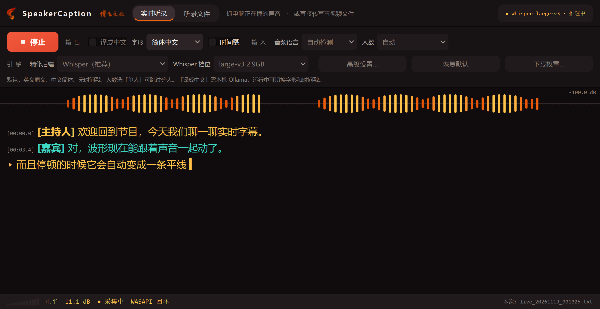
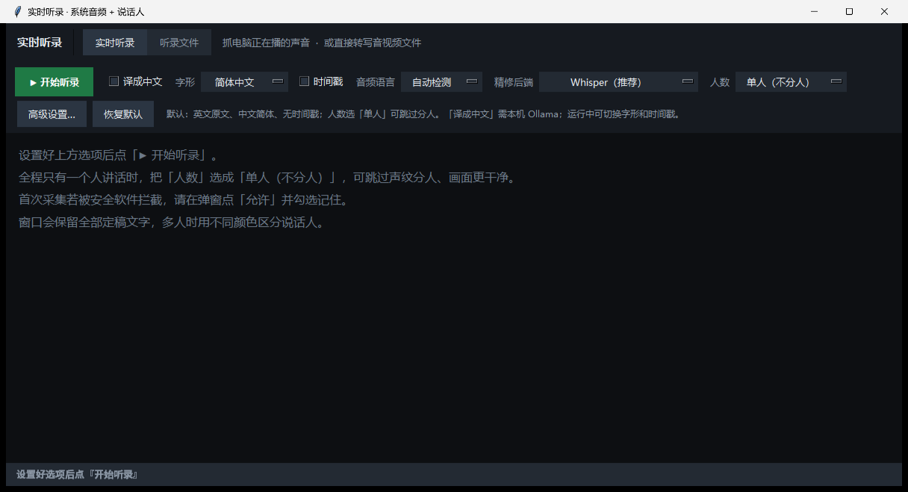

# SpeakerCaption

**简体中文** · [English](README.en.md)

**离线转写音视频 + 实时听录系统声音，两种模式都带说话人分离。**



- `diarize.py`：给一段双人播客 / 多人访谈录音，输出「谁在什么时候说了什么」。
- `live.py`：**抓电脑正在播放的声音**（网络会议、直播播客），边听边出字、边标说话人。

两者都输出 `txt / srt / json / rttm`。整条链路在本地跑，不上传音频、不依赖任何私有服务。

**环境**：Python 3.10+ · Windows / macOS / Linux · 核心分人纯 CPU 即可（约 35 MB 模型）·
有 NVIDIA 显卡时句末精修更快。代码采用 Apache-2.0，各模型权重遵循各自的上游许可。

```
音频 → pyannote 分段 → CAM++ 声纹 → 聚类 → (说话人, 起, 止)
                                        ↓
                          逐段送给 ASR → 带说话人标记的文稿
```

## 特性

- **说话人分离**：pyannote segmentation 3.0 + 3D-Speaker CAM++，经 sherpa-onnx 跑；
  纯 ONNX Runtime，**CPU 即可运行**，实测 15~28 倍实时。
- **ASR 可插拔**：`whisper`（faster-whisper，默认，跨平台）/ `confucius`
  （可选，连接用户自行部署的 Confucius4-R2T2 中文高质量后端）/ `none`（只出分段）。
- **任意输入容器**：wav/flac/ogg 直接读；mp3/m4a/mp4 等自动走 ffmpeg 解码。
- **跨平台**：Windows / macOS / Linux 同一套命令。离线模式不依赖任何音频设备；
  实时模式 Windows 开箱即用，其它平台配虚拟回环设备即可。
  不依赖本机 7861 端口、不依赖任何编译过的私有模块。
- **每次听录独立成稿**：文件名自动带时间戳（如 `live_20261118_233520.txt`），
  听完一段紧接着听新直播，上一场文字稿完整保留、绝不覆盖；也不会一句一个文件。
- **可命名说话人**：`--speaker-names "1=主持人,2=嘉宾"`。
- **文本默认不带时间戳**（`--timestamps` 开启）；srt / json / rttm 始终带精确时间。
- **字形与翻译可控**：默认自动检测语种（英文保持英文）、中文统一转**简体**；
  译成中文、繁体输出、原样保留都是可选项，实时窗口里直接勾选。
- **带选项面板的实时窗口**：翻译 / 简繁 / 时间戳 / 语种 / 后端 / 人数 / 高级参数，
  选择自动保存到 `settings.json`。
- **波形跟着真实声音走**：窗口中间的火焰波形不是装饰动画，柱子取自采集到的
  PCM 峰谷值，静音自动变平线；听录文件时显示整段真实波形与转写进度播放头。

> 两种模式的分工：**离线版 `diarize.py`** 拿到整段音频后全局聚类，标签最稳、可回溯校对；
> **实时版 `live.py`** 每句 VAD 一结束就立刻给标签，绝不回头改，追求低延迟。
> 二者共用同一份 CAM++ 声纹模型和 `rttm/json` 输出格式，可以互相喂结果。

### 和同类项目的区别

「Whisper + 说话人分离」是红海，但绝大多数方案（whisperX、whisper-diarization、
aTrain）都要求 **HuggingFace token + 接受 gated 模型协议 + torch/NeMo 全家桶**，
实时方向又有 WhisperLiveKit / meetily 占满。本项目占的是中间的空位：

**不用 HF token、不用 GPU、不用 torch、35 MB 模型、`pip install` 即用的一次性 CLI**，
并且一次出齐 `txt / srt / json / rttm` 四份带说话人标记的文稿，ASR 可任意替换
（含中文热词后端）。全链路 Apache-2.0 / MIT，无 AGPL 传染性。

完整竞品清单、star/许可快照、检索依据与风险规避见 [docs/RELATED_WORK.md](docs/RELATED_WORK.md)。

## 仓库内容

这个仓库只放**代码和文档**，不放模型权重、虚拟环境或任何运行产物：

| 在仓库里 | 需要你自己准备 |
|---|---|
| 全部源码 `src/`、命令行入口 `live.py` / `diarize.py` | Python 依赖：`pip install -r requirements.txt` |
| 测试 `tests/`、模型与诊断脚本 `scripts/` | **模型权重**：35 MB ~ 2.88 GB，见下节 |
| 文档与界面截图 `docs/`、许可与第三方声明 | Confucius4-R2T2 后端（可选，用户自行部署） |
| Windows 启动器、依赖清单、忽略规则 | `settings.json`（本机配置，首次运行自动生成） |

`.venv/`、`models/`、`out/`、`live_out/`、`settings.json`、测试音频与输出文件
全部由 [.gitignore](.gitignore) 排除，**不会出现在任何提交里**。所以刚 clone 下来
必须按下面的命令下载模型才能跑 —— 这是刻意设计：权重体积大、各有上游许可，
不适合放进 Git。详见文末「许可与合规」与 [THIRD_PARTY_NOTICES.md](THIRD_PARTY_NOTICES.md)。

## 快速开始

需要 Python 3.10+：

```bash
git clone https://github.com/LouisChenParfait/SpeakerCaption.git
cd SpeakerCaption

python -m venv .venv
# Windows: .venv\Scripts\activate     macOS/Linux: source .venv/bin/activate
pip install -r requirements.txt

# ① 必需：分人模型（约 35 MB）
python scripts/download_models.py
# ② 用实时模式（live.py）还需 VAD + 流式 ASR（约 232 MB）
python scripts/download_models.py --with-live
# ③ 要出文字（Whisper 权重，2.88 GB；小档位见下方「模型从哪来」）
python scripts/download_models.py --with-whisper large-v3

python scripts/check_env.py                  # 可选：环境自检
python diarize.py --help
python live.py --help
```

Windows 上建好 `.venv` 后可以直接用启动器：
`run.bat <音频> [参数]` 或 `run_live.bat [参数]`。

> 下载慢或 pip 报 403：可换 PyPI 镜像，例如
> `pip install -r requirements.txt -i https://mirrors.cloud.tencent.com/pypi/simple`；
> 模型下载如被代理挡住，用 `python scripts/download_models.py --proxy http://你的代理:端口`。

### 模型从哪来？（首次使用必读）

**不用假设你电脑里已经装好了 Whisper。** 整个流程是：

| 东西 | 从哪来 | 谁负责 |
|---|---|---|
| `faster-whisper` **代码** | PyPI（`pip install -r requirements.txt`） | pip，几秒 |
| Whisper **权重** | HuggingFace（MIT 许可） | 首次使用时下载，或你手动下好 |
| 分人 / VAD / 流式 ASR 模型 | GitHub Release + HF 镜像 | `scripts/download_models.py` |

权重有三条路，选一条就行：

**A. 一条命令下到工程内（推荐，可离线、可整目录分享）**

```bash
python scripts/download_models.py --with-whisper large-v3
# → models/whisper/large-v3/
```

之后程序**优先读这个目录**，完全不发网络请求。把 `models/` 整个目录打包发给同事，
对方解压即可用，**不需要联网、不需要装 Whisper、不需要再下 2.88 GB**。

**B. 让它自动下载（最省事）**

什么都不做，直接跑 `python live.py`。首次精修时会自动从 HuggingFace 拉权重，
存在 HF 缓存目录（Windows 上是 `%USERPROFILE%\.cache\huggingface\hub\`）。
国内网络建议先设镜像：

```bash
# Windows
set HF_ENDPOINT=https://hf-mirror.com
# macOS / Linux
export HF_ENDPOINT=https://hf-mirror.com
```

**C. 手动下载**

从 <https://huggingface.co/Systran/faster-whisper-large-v3> 下载 `model.bin`、
`config.json`、`tokenizer.json`、`vocabulary.json` 四个文件，放进
`models/whisper/large-v3/`，或直接在界面的「Whisper 模型」里填这个目录的绝对路径。

#### 选哪个档位？

`tiny` 不是「默认档位」，只是**最小的一档**。程序默认用 `large-v3`；
`tiny` / `small` 只是测试时下载过、留在 `models/whisper/` 里的两个档位。
它们和 `large-v3` 用的是同一套代码，差别只在**权重大小 → 速度和准确率**：

| 档位 | 体积 | 速度 | 准确率 | 适合 |
|---|---|---|---|---|
| `tiny` | 72 MB | 最快 | 很低 | 只为「先跑起来看看」，术语基本听错 |
| `base` | 145 MB | 很快 | 偏低 | 草稿级 |
| `small` | 461 MB | 快 | 中 | **CPU 用户的推荐起点** |
| `medium` | 1.42 GB | 中 | 较高 | 质量与体积的平衡点 |
| `large-v3-turbo` | 1.62 GB | 快 | 高 | 大显存 + 追求速度 |
| `large-v3` | 2.88 GB | 慢 | 最高 | **有 NVIDIA 显卡时的推荐**（默认） |

> 换档位只换**权重**，不换代码：`models/whisper/<档位>/` 里放的是同一套
> faster-whisper 权重，程序按目录名自动识别。

**选哪一档由你决定**，两个入口任选其一：

1. **界面里选**（推荐给不懂命令行的使用者）：
   窗口第二行有「**Whisper 档位**」下拉（每个档位后面标着体积）和
   「**下载权重…**」按钮。选好档位点按钮，程序在后台从 HuggingFace 拉权重
   放进 `models/whisper/<档位>/`，下完整个目录可以整个拷给同事，**离线可用**。
2. **命令行**：

```bash
# 下指定的档位
python scripts/download_models.py --with-whisper small
# 一次下多个
python scripts/download_models.py --whisper-tier small medium
# 国内网络走镜像
python scripts/download_models.py --with-whisper large-v3 --endpoint https://hf-mirror.com
```

查看本机已有哪些模型、各自多大、在哪：

```bash
python scripts/whisper_models.py list
python scripts/whisper_models.py path large-v3
```

> 没有 GPU 也能跑，只是 CPU 上 `large-v3` 会明显拖慢句末定稿。
> 这时用 `--whisper-model small --whisper-device cpu` 更划算。

只要核心分离能力（不装 ASR、CPU、约 35 MB 模型）：

```bash
pip install -r requirements-core.txt
python diarize.py interview.wav --asr none
```

跑一次自检（需先下载官方测试音频）：

```bash
python scripts/download_models.py --with-test-audio
python tests/test_smoke.py
```

## 典型用法

```bash
# 双人播客（中文，已知 2 人），用默认 Whisper 后端
python diarize.py podcast.wav --num-speakers 2 --language zh

# 中文质量优先：进程内直调 Confucius4-R2T2，不用先起 7861 服务，还加热词
python diarize.py podcast.wav --num-speakers 2 --asr confucius-local \
    --hot-word "大涨小降,禀督工"

# 或者用你自己起的 7861 服务（老方式）
python diarize.py podcast.wav --num-speakers 2 --asr confucius \
    --hot-word "大涨小降,禀督工" --confucius-url http://127.0.0.1:7861

# 五六人会议：明确人数最稳；顺便给说话人改名、转简体
python diarize.py meeting.m4a --num-speakers 6 --speaker-names "1=主持人,2=张三" \
    --simplify --language zh

# 视频文件也可以（自动抽音轨）
python diarize.py 发布会.mp4 --num-speakers 2 --script simplified

# 不知道人数：自动估计（阈值越大估计出的人越少）
python diarize.py talk.mp3 --num-speakers -1 --threshold 0.7

# 只做分离，不要文字（最快，可对接别的 ASR）
python diarize.py panel.wav --num-speakers 4 --asr none --formats rttm,json
```

结果写到 `out/<文件名>.{txt,srt,json,rttm}`。

**关于人数**：知道人数就一定要用 `--num-speakers N` 明确指定，这是提升准确率最有效的
一步。自动估计适合探索，但抢话、重叠语音、远场麦克风会让它多估或少估。

## 实时听录（网络会议 / 直播播客）

不是给一个 mp3，而是**直接听电脑此刻正在播放的声音**。Windows 上不需要任何设置：

```bash
# 双人直播播客，已知 2 人
run_live.bat --num-speakers 2 --speaker-names "1=主持人,2=嘉宾"

# 单人直播 / 讲座 / 录屏旁白：全程只有一个人讲话，压根不做分人
run_live.bat --single-speaker

# 五六人网络会议，中文质量优先（需自己先启动 7861 的 Confucius 服务）
run_live.bat --num-speakers 6 --final confucius --hot-word "公司名,产品名" --language zh

# 先拿文件验一下效果，不用真的开会
run_live.bat --simulate tests/data/1-two-speakers-en.wav --num-speakers 2

# 录 10 分钟自动停（0 = 一直跑，关窗口即停）
run_live.bat --num-speakers 2 --duration 600

# 无界面模式：直接在控制台跑，适合脚本 / 服务器 / 无人值守
python live.py --no-gui --single-speaker --duration 600
```

> `live.py` **默认打开图形窗口**并等人点「▶ 开始听录」；要让它在控制台里自己跑，
> 必须加 `--no-gui`。少了这个参数时进程会一直开着窗口不退出、也不打印日志。

**采集后端可插拔**：Windows 默认 WASAPI 回环（抓默认输出设备，不用启用「立体声混音」，
USB / HDMI / 蓝牙声卡通吃）；macOS 装 BlackHole、Linux 用 PulseAudio monitor 后走
`sounddevice`（`--list-devices` 看设备）；`--simulate` 用 wav 按实时节奏回放。

**链路**：

```
系统声音 → VAD 断句 → 流式 Paraformer 边听边出字（黄色 ▷）
                    ↘ CAM++ 声纹 → 在线增量匹配 → 立刻贴说话人标签
                    ↘ 整句说完 → whisper / Confucius 精修 → 覆盖定稿（按人着色）
```

窗口保留全部历史行，不同说话人不同颜色，底部状态条显示电平、设备与静音告警。
每定稿一句就重写一次本次的文件，中途断电也不丢已出的字；
**每次点「开始听录」都新建一组带时间戳的文件**，上一场内容完整保留，不会互相覆盖。

### 听录媒体文件（音频 / 视频）

同一个窗口还有第二个模式：**听录文件**。切过去选一个音视频文件即可，
不用开命令行，转写结果同样上屏、同样出 txt/srt/json/rttm。

- 支持 `mp3 / m4a / wav / flac / aac / ogg / opus / wma` 以及
  `mp4 / mkv / mov / avi / webm / flv / wmv / ts`（**视频自动抽音轨**）
- 分辨说话人、简繁转换、译成中文、时间戳 —— 与实时模式完全一致
- 产物按**原文件名 + 时间戳**存到输出目录
  （`会议录音.mp4` → `live_out/会议录音_20261118_233520.txt`），同一文件转写多次不会互相覆盖
- 命令行等价物就是 `diarize.py`：`python diarize.py 会议.mp4 --num-speakers 2`

文件模式走的是**离线整段管线**（全局聚类分人），比实时模式的在线增量分人更准；
代价是必须等整个文件处理完才出结果。

### Confucius 本地后端（不用再手动起服务）

`--final confucius` 这个后端需要你先在别处启动 Confucius4-R2T2 的 Gradio 服务
（7861 端口）。**新增的 `confucius-local` 后端免掉了这一步**：

```bash
# 进程内直接调 Confucius4-R2T2，工具自己拉起子进程，你什么都不用管
run_live.bat --final confucius-local
python diarize.py 会议.mp4 --asr confucius-local
```

它怎么做到的：`Confucius4-R2T2` 的推理核心是编译模块 `cy_app.pyd`，依赖 torch。
本项目**不把 torch 装进自己的虚拟环境**（那是 2.5 GB+ 的负担，还和
faster-whisper 的 ctranslate2 栈互相干扰），而是**用 Confucius 自带的那个
Python 解释器**起一个 worker 子进程，在那边进程内调 `cy_app.do_text()`，
结果通过管道传回来。

- 不用占 7861 端口，不用手动开服务
- 模型只加载一次，多句之间复用
- 本项目侧零新增重量级依赖（只是多了个几十 KB 的 worker 脚本）
- 找不到项目目录时，在高级设置填「Confucius 项目目录」，
  或设环境变量 `CONFUCIUS_DIR=<你的 Confucius4-R2T2 目录>`

| 后端 | 需要你准备什么 | 说明 |
|---|---|---|
| `whisper`（默认） | 无 | 跨平台，英文强 |
| `confucius-local` | 装好 Confucius4-R2T2 | **推荐**：中文标点 + 热词，免启服务 |
| `confucius` | 自己起 7861 服务 | 老行为，保留兼容 |
| `none` | 无 | 只出分段，不要文字 |

### 模型文件在哪里

| 模型 | 位置 | 大小 |
|---|---|---|
| 声纹 CAM++ | `models/3dspeaker_speech_campplus_*.onnx` | 27 MB |
| 分段 pyannote | `models/sherpa-onnx-pyannote-segmentation-3-0/` | 小 |
| 流式 Paraformer | `models/streaming-paraformer/` | 小 |
| **Whisper（可选）** | **工程内 `models/whisper/<档位>/` 优先，否则 HF 缓存** | **72 MB ~ 2.88 GB** |

Whisper 权重有**两个可能的位置**，程序按这个顺序找：

1. `models/whisper/<档位>/` —— 你用 `--with-whisper` 主动下的，**跟着工程走、可整目录分享**
2. `%USERPROFILE%\.cache\huggingface\hub\models--Systran--faster-whisper-<档位>\`
   —— 首次运行自动下载的缓存

所以在 `models/` 里找不到它不一定是没下，可能在 HF 缓存里；反之如果
`models/whisper/` 有目录，程序会优先用它、**完全不发网络请求**。

```bash
python scripts/whisper_models.py list              # 看本机缓存了哪些、各多大
python scripts/whisper_models.py path large-v3     # 打印完整路径
python scripts/whisper_models.py link large-v3     # 在工程 models/whisper/ 建链接（不复制数据）
```

「Whisper 模型」选项填 `large-v3` 即可（自动按上面的顺序找）；
也可以直接填完整路径或目录，从磁盘直读。

### 界面上的功能选项

`run_live.bat` 直接打开带设置面板的窗口，点「▶ 开始听录」才开流：



| 选项 | 默认 | 说明 |
|---|---|---|
| 译成中文 | 关 | 勾上后把识别出的外文送到**本机 Ollama** 译成中文；不勾则英文保持英文 |
| 字形 | 简体中文 | 可切 `繁体中文` / `保持原样`（不做简繁转换） |
| 时间戳 | 关 | `.txt` 与窗口每行前加 `[mm:ss.s]` |
| 音频语言 | 自动检测 | 可强制 `中文` / `英文` |
| 精修后端 | Whisper | 可换 **Confucius 本地（免启服务）** / Confucius 服务 / 仅流式草稿 |
| 人数 | 自动 | 双人播客选 2、会议选实际人数最稳；**全程只有一个人讲话时选「单人（不分人）」** |
| Whisper 档位 | large-v3 | 权重体积 vs 速度/准确率的取舍表；旁边有「下载权重…」可直接下到工程内 |
| 高级设置 | — | Whisper 模型与设备、**Confucius 项目目录**、热词、Ollama 地址与翻译模型、输出目录、阈值、时长等 |

窗口顶部还有**模式切换**：实时听录（抓系统声音）/ 听录文件（转写音视频）。
上次用的模式会记住，下次打开还在同一页。

设置保存在 `settings.json`；**命令行参数只对当次启动覆盖**，不会被写回文件
（临时用 `--simulate` 验收不会变成下次的永久设置）。运行中可**即时切换字形和
时间戳**（已上屏的历史与输出文件会一起重算），翻译 / 语种 / 后端 / 人数需停止后改。

> **界面里出现的是测试音频、不是电脑正在播的声音？**
> 看状态栏：写「文件回放 xxx.wav」说明「高级设置 → 模拟回放 wav」还填着文件，
> 这时程序按文件回放、不抓系统声音。清空那一项就会切回真实回环采集
> （状态栏显示「WASAPI 回环 idx=xx …」）。命令行 `--simulate` 只对当次启动有效，
> 不会污染这个设置。

### 波形跟着声音走


窗口中间那条火焰色波形**不是装饰动画**：

- **实时听录**：每根柱子是一个 20ms 片段的真实采样最小值 / 最大值，
  显示最近约 2.2 秒，左旧右新滚动。有人说话就起伏、停顿就压成一条平线，
  右上角有实时 dB 读数。**没声音时波形是平的，这是正常的**，
  不是卡住；状态条的「连续 Ns 没收到声音」才需要检查设备。
- **听录文件**：文件解码后立即画出整段音频的真实波形总览，
  已转写部分点亮成火焰色、未转写部分是暗色，金色播放头按段落的
  **结束时间**（不是段数）前进，所以长段和空白在画面上的位置与音频一致。
- **准备 / 待机**：模型还没加载完、确实没有音频可画时，才用低幅呼吸线
  表示「程序活着」。命令行 `--no-gui` 不创建这条通路，零额外开销。

实现上采集回调（`AudioSource._put`）把原始 PCM 降采样进线程安全的
`wave_meter.WaveMeter` 环形缓冲，Qt 控件每 40ms 自己拉帧绘制，
不经过 150ms 的 `LiveDisplay` 轮询；可视化出任何异常都不会影响音频采集。
更多设计细节见 [docs/UI_DESIGN.md](docs/UI_DESIGN.md) 第 5.7 节。

### 单人模式（不分人）

直播里最常见的情况其实是**全程只有一个人在讲话**——单人旁白、讲座、录屏解说、
solo 播客。这种场景下做在线分人没有意义，反而制造麻烦：同一个人的短句会因为
声纹采样太少被判成「新说话人」，标签在窗口里乱跳。

选「人数 → **单人（不分人）**」（或命令行 `--single-speaker` / `--num-speakers 1`）后：

| | 普通模式 | 单人模式 |
|---|---|---|
| 声纹模型 | 加载 CAM++ | **不加载**，省内存也省 CPU |
| 每句 embedding | 每句算一次 | **不算** |
| 说话人标签 | 在线增量匹配 | 恒定一个人 |
| 窗口与 `txt`/`srt` | 显示「说话人1：」 | **不显示任何说话人前缀**，是纯字幕 |
| `json` 的 speaker 字段 | 真实标签 | 固定 `1`（便于下游程序统一处理） |
| `voices.json` 声纹存档 | 会写 | 不写（没有声纹可存） |

这个开关在**实时听录**和**听录文件**两个模式里都生效，两边口径完全一致：

* 实时听录：跳过 CAM++，窗口是纯字幕；
* 听录文件：**只断句、不做声纹分离**（连 pyannote 分割模型也不加载），
  窗口和 `txt` / `srt` 里同样不会出现「【说话人1】」。
  状态栏会写明「单人模式：只断句，不做声纹」。

> 单人模式下 `json` 里仍然保留 `speaker: 1` 字段——那是给下游程序用的
> 结构化信息，不是给人看的说话人标签。

`--single-speaker` 只是 `--num-speakers 1` 的别名，三种写法（GUI 下拉、命令行别名、
数字 1）归一到同一个开关。`.rttm` 仍按标准说话人日志格式输出，speaker 恒为 `SPEAKER_1`。

点「■ 停止」后窗口会先显示「正在停止…（等待最后几句定稿）」，等采集线程收尾、
剩余句子写完盘，按钮才会恢复成「▶ 开始听录」；一般几秒内完成，若队列积压较多
状态条会显示已等待秒数。收尾超过 12 秒仍在跑时可直接关窗口强制退出。

**可以反复开始 / 停止**：每轮都是全新会话、新建一组带时间戳的输出文件（旧稿保留）。
所有 WASAPI / PortAudio 调用固定跑在进程内**唯一一条音频线程**上：跨线程重新开流
会触发 `Pa_OpenStream -9999 Unanticipated host error`，因此每轮只重建数据队列与
状态，不换线程；各轮的停止事件相互独立。

> **为什么默认自动检测语种？**
> 若把 `--language` 强制设成 `zh`，Whisper 遇到英文语音会把一部分句子解码成
> 中文译文、另一部分仍留英文（同一次运行里简繁混杂）；large-v3 的中文输出本身
> 也高频出现繁体。因此默认 `auto` 让模型自己判语种，再用 OpenCC 把中文统一转
> 简体；要译文就明确勾「译成中文」，走本地模型翻译，而不是靠 ASR 的副作用。
>
> 纯英文语音下，中文流式 Paraformer 的黄色草稿是谐音噪声，程序检测到非中文语音后
> 会自动隐藏草稿，只显示句末精修的原文。

对应命令行参数（`--no-gui` 模式同样生效）：
`--script simplified|traditional|as-is`、`--translate`、`--translate-model`、
`--ollama-url`、`--language auto|zh|en`、`--timestamps`。离线版 `diarize.py`
也支持同一组文本选项。翻译成汉语需要本机已启动 Ollama（默认 `127.0.0.1:11434`），
`--translate-model auto` 会优先挑已安装的翻译专用模型；不可用时保留原文并在状态条提示。

**实测延迟**（RTX 4090 D，官方四人中文 56.9s 音频，Whisper GPU 精修）：
首字上屏距 VAD 判定语音起点平均 **0.06s**、最大 0.13s；句末定稿平均 **0.29s**、
最大 0.56s。纯 `--final none` 时定稿零延迟，但没有标点。

**在线分人和离线聚类不一样**：这里每句结束就立刻定标签，绝不回头改。
实测官方双人音频同人声纹相似度 0.72~0.77、跨人 0.30~0.38，默认阈值 0.60 余量充足；
`--num-speakers` 能锁住人数上限。短于 1 秒的句子声纹不可靠，会沿用上一句标签。
退出时把声纹中心存到 `live_out/voices.json`，下次 `--enroll live_out/voices.json`
可以让同一个人跨多次会议保持同一个标签和名字。

> **安全软件拦截**：部分杀毒软件在程序首次访问音频设备时会弹「正在试图访问
> 麦克风」，允许并记住选择即可。被拦时回环流仍会「打开成功」但数据全 0
> （不出字，底部状态条 20 秒后变红写明原因）。注意这与停止后再开流的
> `-9999` 无关，后者是音频线程亲和性问题，已在代码内规避。若确实开流失败，
> 先确认系统正在播放声音、默认输出设备没被切换，必要时在管理员命令行执行
> `net stop Audiosrv && net start Audiosrv`。程序仍保留 4 次退避重试。

**已知局限**：重叠说话人（抢话）会被判给其中一人；每人只说一两句时中心不够稳，
错分率高于离线全局聚类；纯流式草稿无标点，`--final whisper/confucius` 才会补上。
需要最稳的标签时，可以会后再把录下来的音频丢给 `diarize.py` 重跑一遍。

## 输出位置

实时听录的结果写在**工程目录下的 `live_out/`**。每点一次「开始听录」就新建一组
带时间戳的文件，听完一段紧接着听下一段，上一场文字稿不会被覆盖：

```
live_out/
├── live_20261118_233520.txt   ← 第一场：纯文字（每行一句）
├── live_20261118_233520.srt   ← 第一场：字幕（带时间轴）
├── live_20261118_233520.json  ← 元信息 + 每段 start/end/speaker/text
├── live_20261118_233520.rttm  ← 标准说话人日志格式
├── live_20261118_234941.txt   ← 第二场，独立保留
├── ...
└── voices.json                ← 声纹存档（多人模式才有；单人模式不生成）
```

命名规则：`<前缀>_<YYYYmmdd_HHMMSS>`，同一秒内连开两次自动加 `_2` / `_3`；
文件模式的前缀是**原文件名**（`会议录音_20261118_233520.txt`）。
界面右下角始终显示「本次: xxx.txt」，鼠标悬停可看完整输出目录；
`*.json` 里也有 `session_id` / `session_started_at` 便于程序追溯。

- 改目录：**高级设置 → 输出目录**；命令行 `--outdir`（相对路径按**工程根目录**解析，
  从任何地方启动都写到这里）。
- 改前缀：命令行 `--stem myname` → `live_out/myname_<时间戳>.txt`。
- 想回到固定文件名并覆盖（批处理脚本用）：`--stem-suffix none`，此时 `--stem live`
  就写 `live.txt`，每次启动重建。
- 中途断电也不丢已出的字（每定稿一句就重写一次**本次**的文件）。
- **准备阶段有明确反馈**：点开始后窗口中央显示「正在准备，请稍等…」、火焰色
  不定态进度条、5 步阶段文字与已等待秒数，状态条同步显示进度；模型加载完
  自动切回字幕区。加载失败会在状态条报错，不会把界面卡在动画上。
- 离线版 `diarize.py` 默认写到 `out/`。

## 输出示例

`*.txt`（默认不带时间戳）

```
说话人1：这是一个测试说话人日志的音频，下面我们来播放一些测试音频
说话人2：非常累的时候就会站在阳台上吹吹风
```

`*.srt`

```
1
00:00:00,320 --> 00:00:06,870
[说话人1] 这是一个测试说话人日志的音频，下面我们来播放一些测试音频
```

`*.rttm`（标准说话人日志格式，可导入其它标注工具）

```
SPEAKER interview 1 0.320 6.550 <NA> <NA> speaker_01 <NA> <NA>
```

`*.json` 含每段的 start/end/speaker/text，以及本次使用的模型、后端、耗时等元信息。

单人模式下 `*.txt` / `*.srt` 是**不带说话人前缀的纯字幕**：

```
这是一个测试说话人日志的音频，下面我们来播放一些测试音频
非常累的时候就会站在阳台上吹吹风
```

```
1
00:00:00,320 --> 00:00:06,870
这是一个测试说话人日志的音频，下面我们来播放一些测试音频
```

## 主要参数

| 参数 | 默认 | 说明 |
|---|---|---|
| `--num-speakers` | `-1` | 已知说话人数；`-1` 自动估计；`1` 等同单人模式 |
| `--single-speaker` | 关 | 单人直播快捷开关：跳过声纹模型，输出纯字幕（实时版） |
| `--threshold` | `0.7` | 自动估计时的聚类阈值，越大人越少 |
| `--asr` | `whisper` | `none` / `whisper` / `confucius` / `confucius-local` |
| `--whisper-model` | `large-v3` | 可换 `medium` / `small` / 本地路径，越小越快越省显存 |
| `--whisper-device` | `auto` | `auto` / `cuda` / `cpu`，CUDA 初始化失败自动回退 CPU |
| `--language` | `auto` | 自动检测；强制 `zh` 会让英文语音被解码成中文译文，慎用 |
| `--hot-word` | 空 | 仅 Confucius 后端，逗号分隔 |
| `--confucius-url` | `http://127.0.0.1:7861` | 用户自部署服务地址（仅 `--asr confucius`） |
| `--confucius-dir` | 自动探测 | Confucius4-R2T2 项目目录（仅 `--asr confucius-local`）；也可用环境变量 `CONFUCIUS_DIR` |
| `--script` | `simplified` | `simplified` / `traditional` / `as-is`，需 `opencc-python-reimplemented` |
| `--translate` | 关 | 用本机 Ollama 把外文译成中文（仅在外文占比高时触发） |
| `--translate-model` | `auto` | 自动挑已安装的翻译模型；也可指定模型名 |
| `--ollama-url` | `http://127.0.0.1:11434` | 本地翻译服务地址 |
| `--timestamps` | 关 | `.txt` 每行前加时间戳 |
| `--speaker-names` | 空 | `"1=张三,2=李四"` |
| `--merge-gap` | `0.3` | 合并同一人间隔 ≤ 该秒数的相邻段 |
| `--seg-int8` | 关 | 用 int8 分段模型；更快更小，但多人场景会合并说话人（见 DEVLOG） |
| `--formats` | `txt,srt,json,rttm` | 需要的输出格式 |
| `--outdir` | `out` | 输出目录 |

完整列表：`python diarize.py --help`

## 实测（RTX 4090 D / Windows）

| 样本 | 时长 | 分离 | 分段 | 说话人 | 速度 |
|---|---|---|---|---|---|
| 官方双人英文 | 16.00s | 0.59s | 4 | 2 ✓ | 27x 实时 |
| 官方四人中文 | 56.86s | 3.76s | 10 | 4 ✓ | 15x 实时 |

加 `faster-whisper large-v3 (cuda/float16)` 后，四人中文 10 段转写耗时 2.41s，
整条流程 10.37s 完成。Whisper 中文偶发繁体字，现在默认 `--script simplified` 自动
用 OpenCC 修正；要繁体就选 `--script traditional`。

**实时模式**（`live.py --final whisper`）：同一份四人中文音频按实时节奏回放，
VAD 切出 7 句、正确分出 4 人；首字上屏距语音起点平均 0.06s / 最大 0.13s，
句末定稿平均 0.29s / 最大 0.56s。双人英文音频 4 句标签与离线聚类结果完全一致。
真实 WASAPI 回环开流 0.08s、正常优雅退出。详见 [docs/DEVLOG.md](docs/DEVLOG.md) §14。

## 许可与合规

| 资产 | 许可 | 是否随仓库分发 |
|---|---|---|
| 本项目代码 | Apache-2.0 | 是 |
| pyannote segmentation 3.0 ONNX | MIT (CNRS) | 否，首次运行下载 |
| 3D-Speaker CAM++ ONNX | Apache-2.0 | 否，首次运行下载 |
| Silero VAD ONNX（实时模式） | MIT | 否，`--with-live` 下载 |
| Streaming Paraformer zh-en int8（实时模式） | Apache-2.0 / 见模型卡 | 否，`--with-live` 下载 |
| sherpa-onnx / faster-whisper | Apache-2.0 / MIT | 否，pip 安装 |
| Confucius4-R2T2 代码 | Apache-2.0 | 否，用户自行部署 |
| Confucius4-R2T2 **模型权重** | **网易模型使用许可协议（非 OSI 开源）** | **绝不分发** |

硬边界，务必遵守：

1. **不要把任何模型权重放进 Git 仓库**。网易权重协议 §3.4 a) 要求下游受同等条款约束，
   §2.2 对超大规模商用另有授权门槛，§4.2 列出禁用场景。正确说法是
   `Code: Apache-2.0 / Weights: NetEase Model Use License (not OSI)`。
2. **不要上传 `cy_app*.pyd` 或任何编译产物**。Confucius 部署包里的编译模块没有源码、
   绑定私有服务链路，既不可分发也说不清来源；本项目的 Confucius 后端只是标准
   HTTP 客户端，不含任何厂商代码。
3. **声纹是生物识别信息**。说话人分离不得用于大规模生物识别监控、自动化决策
   （信贷/就业评估）等场景；使用本项目处理他人录音前请取得同意并遵守当地法律。

详见 [THIRD_PARTY_NOTICES.md](THIRD_PARTY_NOTICES.md) 与 [docs/DEVLOG.md](docs/DEVLOG.md)。

## 排错

**「明明是两个人，却全标成【说话人1】」** —— 先跑诊断脚本，它会照抄实时链路的
分人过程，把每段的标签、分数和段间余弦相似度矩阵打出来：

```bash
python scripts/check_speakers.py 你的音频.wav --num-speakers 2
```

判读标准：同一说话人的相似度一般 **>= 0.7**，不同人 **< 0.5**。
若看到「相似度明明很低却判成同一人」，说明那一段太长（广播音频里 VAD 切出的段
动辄十几秒），整段一个声纹把好几个人平均掉了——程序已经改成按 3 秒窗投票分人，
若仍不准，可把高级设置里的「声纹相似度阈值」调低到 0.5 再试。

## 已知限制

- 重叠语音（多人同时说）目前不会拆成多路，ASR 会丢字；实时版会判给其中一人。
- 离线版说话人标签只在**单个文件内**一致；实时版可用 `--enroll` 载入上次声纹跨次保持一致。
- 实时版每句立刻定标签、绝不回头改，每人只说一两句时错分率高于离线全局聚类。
- 实时版按 **3 秒窗**取声纹投票分人：广播/直播音频里 VAD 切出的段动辄十几秒
  （电台几乎不停顿，0.45 秒静音门槛触发不了），整段算一个声纹会把几个人平均成
  一个谁都不像的向量，导致整场只剩【说话人1】。切窗后长段里的换人能分开，
  但**一段里只有一两句短话**时仍可能判不准。
- 自动人数估计在 6 人以上、远场录音时偏差明显，建议显式给人数。
- 分段边界由模型给出，srt 时间码会随 `--merge-gap` 略有合并。
- 实时采集在 Windows 开箱即用；macOS / Linux 需自行装虚拟回环设备（BlackHole / PulseAudio monitor）。
- 「译成中文」依赖本机 Ollama，且大模型与 GPU 版 Whisper 同时加载可能吃满 24GB 显存；
  如遇显存不足，把高级设置里的推理设备改成 CPU，或换更小的翻译模型。翻译按句调用，
  会给句末定稿增加额外延迟；不可用时保留原文并提示，不影响听录。
- 中文流式 Paraformer 只认中文；纯英文语音的黄色草稿会自动隐藏，以句末精修原文为准。

## 路线图

- [x] 与实时字幕链路对接（`live.py`：系统声音 → 流式出字 → 在线分人）
- [x] 说话人注册（实时版 `--enroll` / `--save-voices`，跨次保持标签）
- [x] 实时窗口功能选项面板（翻译 / 简繁 / 时间戳 / 语种 / 后端 / 人数，持久化）
- [ ] Gradio / 网页界面（跨平台，可局域网访问）
- [ ] 重叠语音检测与多通道分离
- [x] 实时版长段切窗复核：VAD 切出十几秒的长段时，按 3 秒窗投票分人，
      避免整段一个声纹把多人平均成「说话人1」

## 反馈与贡献

实时采集和声卡 / 系统版本强相关。提 issue 时请附上：

- 操作系统与版本、Python 版本
- 默认输出设备型号，以及 `python live.py --list-devices` 的输出
- 完整命令行（或界面勾选了哪些选项）、状态条提示、`live_out/*.json` 里的元信息
- 能复现问题的最小音频样本 —— **请勿上传含他人语音或隐私内容的会议录音**

分人不准可先跑 `python scripts/check_speakers.py 你的音频.wav --num-speakers 2`，
把每段的余弦相似度矩阵贴出来，比一句「没分出来」有用得多。
欢迎 PR：新增 ASR 后端、新平台采集实现、新的输出格式都预留了接口。

## 致谢

[k2-fsa/sherpa-onnx](https://github.com/k2-fsa/sherpa-onnx)（Apache-2.0）、
[pyannote/segmentation-3.0](https://huggingface.co/pyannote/segmentation-3.0)（MIT）、
[modelscope/3D-Speaker](https://github.com/modelscope/3D-Speaker)（Apache-2.0）、
[SYSTRAN/faster-whisper](https://github.com/SYSTRAN/faster-whisper)（MIT）。
