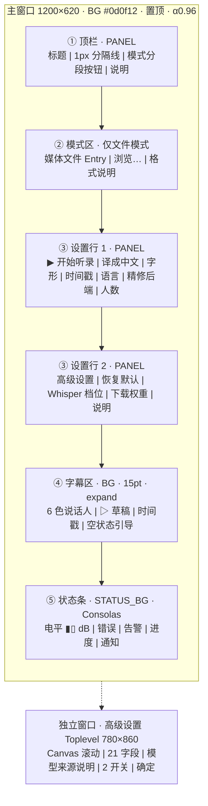
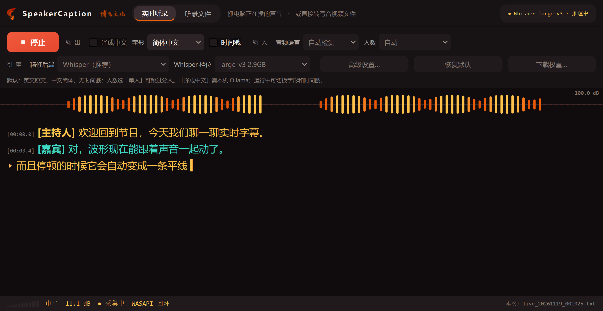

# SpeakerCaption UI 设计系统

> 桌面端实时字幕窗口的视觉规范、组件库、状态模型与开发者交接文档。

| 项目   | 内容                                                                                                                   |
| ---- | -------------------------------------------------------------------------------------------------------------------- |
| 适用对象 | `live.py` 启动的主窗口：**默认 PySide6 Qt 版**（`live_gui_qt.py`，「曜石 × 火焰」）；Tkinter 版（`live_gui.py`）为未安装 PySide6 时的回退 |
| 技术栈 | Python 3.12 / PySide6 6.x（默认）· Tkinter（回退）· QSS 样式表 |
| 主要实现 | Qt 视图层 `live_gui_qt.py` · Tk 视图层 `live_gui.py` · 两者共用控制层 `live_ui.py` 与状态容器 `LiveDisplay` |
| 文档版本 | 1.2 · 2026-11-19 |
| 配套文档 | [README.md](../README.md) · [DEVLOG.md](DEVLOG.md) · [RELATED\_WORK.md](RELATED_WORK.md) |
| 界面截图 | [ui-options.png](ui-options.png) · [ui-file-mode.png](ui-file-mode.png) · [ui-whisper-tier.png](ui-whisper-tier.png) · [ui-preparing.png](ui-preparing.png) · [ui-waveform.png](ui-waveform.png) |

> **适用范围提示（1.1 补）**：第 2~4 章的令牌、组件与布局描述以 **Tkinter 回退版**
> 为准，那是本文件 1.0 的写作对象。本机已安装 PySide6，`live_ui.py` 会优先导入
> `live_gui_qt.py`，**实际看到的是「曜石 × 火焰」Qt 界面**：独立的暖调令牌
> （`BG #100C0D` / `BRAND #D94B00` / 火焰渐变）、SVG 品牌资源、`WaveWidget`
> 声波可视化、分组式高级设置。**第 5 章状态模型、第 7 章文案口径、第 10 章改动矩阵
> 对两套视图层都成立**，因为 `LiveDisplay` / `UIController` / `settings.UI_KEYS`
> 是共用的。Qt 版新增的准备态见 5.6、真实音频波形见 5.7。

---

## 0. 这份文档怎么用

- **改视觉**：只读第 2 章（令牌）+ 第 3 章（组件），改 `live_gui.py` 顶部常量区即可全局生效。
- **加控件 / 加选项**：读第 10.1 节的「改动类型 → 涉及文件」矩阵，那里列了会静默失效的坑。
- **排查显示异常**：读第 9 章，Tkinter 的几个布局陷阱都钉在代码注释里。
- **做设计验收**：读第 8 章的对比度实测 + 第 10.2 节检查清单。

**维护约定**：所有颜色、字号、间距必须引用第 2 章的令牌常量，禁止在控件创建处硬编码色值。文件头注释写得很直白 —— 「照此改，不要临时加颜色」。

---

## 1. 概述与设计哲学

### 1.1 这是什么

一个 **1200×620 的深色桌面窗口**，用于实时听录系统声音或转写音视频文件，同时展示流式字幕、说话人区分和采集电平。它不是网页，没有响应式断点，靠的是 Tkinter 的 `pack` 几何管理和一套手工维护的设计令牌。

### 1.2 五条设计原则

1. **少颜色 + 强层次**：背景分三级灰阶，靠明度差分层，不靠描边。全局语义色只有三个。
2. **一个视觉锚点**：主操作按钮是唯一的高饱和色块，运行中变红成为第二个锚点。
3. **字幕是主角**：字幕区 15pt，是正文 10pt 的 1.5 倍，并占满全部剩余空间。
4. **4 的倍数**：所有内边距取 4 的倍数，控件间留 8~12px。
5. **不用渐变、阴影、圆角、描边**：Tkinter 画不好这些，改用「色块 + 明度差」表达层次。

### 1.3 文件分工（重要）

| 层    | 文件             | 职责                                        |
| ---- | -------------- | ----------------------------------------- |
| 视图层  | `live_gui.py`  | 设计令牌、组件封装、布局、渲染、`status_text()`           |
| 控制层  | `live_ui.py`   | `UIController`：启停线程、设置读写、选项校验、文件听录        |
| 引擎层  | `live_core.py` | 采集/转写/分人；**也直接调用 `display.*` 喂入错误与状态**    |
| 持久化  | `settings.py`  | `UI_KEYS` 33 项白名单，白名单外的键会被无声丢弃            |
| 导出格式 | `outputs.py`   | `speaker_name()`、`stamp()` —— 界面标签与导出文件共用 |

> ⚠️ 「UI 改动只改 `live_gui.py` + `live_ui.py`」**只在纯视觉改动时成立**。新增选项、改选项取值、改错误文案、改说话人标签格式，都需要动别的文件。详见 **10.1 改动类型 → 涉及文件矩阵**。

---

## 2. 设计基础 · Design Tokens

全部定义在 `live_gui.py:33–62`，是唯一真相源。

### 2.1 色彩系统

**背景层级（越靠上层越亮）**

| 令牌           | 色值        | 用途                          |
| ------------ | --------- | --------------------------- |
| `BG`         | `#0d0f12` | 窗口底色、字幕区底色                  |
| `PANEL`      | `#161a20` | 顶栏、设置面板                     |
| `STATUS_BG`  | `#232a33` | 状态条、下拉框、分段按钮容器              |
| `CONTROL`    | `#2b3542` | 可交互控件底、选中态、复选框选中块           |
| `CONTROL_HI` | `#3b4959` | 控件悬停 `activebackground`     |
| `LINE`       | `#0a0c0f` | 1px 竖分隔线（**比面板更暗**，用凹陷表达分层） |

**文本层级**

| 令牌         | 色值        | 用途              | 对比度（见第 8 章）  |
| ---------- | --------- | --------------- | ------------ |
| `FG`       | `#e8edf2` | 主文字             | 14.82:1 ✅    |
| `MUTED`    | `#8c98a6` | 次要说明、未选中态、状态条默认 | 5.95:1 ✅     |
| `FAINT`    | `#6d7a89` | 最弱信息：时间戳、空状态提示  | **4.38:1 ❌** |
| `FINAL_FG` | `#39ff88` | 字幕定稿正文、正常状态条    | 14.47:1 ✅    |

**语义色（全局仅三个，各带悬停态）**

| 语义       | 默认               | 悬停/强调               | 用途             |
| -------- | ---------------- | ------------------- | -------------- |
| 主操作 / 成功 | `ACCENT #1f7a45` | `ACCENT_HI #2a9a58` | 开始按钮、下载完成、确定按钮 |
| 危险 / 停止  | `DANGER #a83636` | `DANGER_HI #c74444` | 运行中按钮、错误提示     |
| 警告       | `WARN #ffb35c`   | —                   | 文件未选、开流偏慢      |

**已知令牌泄漏点（设计债）**：以下代码没有引用令牌，是后续收敛时的第一批目标。

| 位置                               | 硬编码色                              | 对应令牌 / 问题                |
| -------------------------------- | --------------------------------- | ------------------------ |
| `status_text()` :236/245/247/248 | `#ff6b6b` · `#ffb35c` · `#7dffa8` | 状态条四种语义色未提炼成令牌           |
| `start_click()` :799             | `#ff6b6b`                         | 与状态条错误色重复，应共用            |
| 高级窗口 Scrollbar :590              | `#232a33` · `#2e3844`             | 前者等于 `STATUS_BG`，后者无对应令牌 |
| 高级窗口下拉 :623/625                  | `#232a33`                         | 等于 `STATUS_BG`           |
| 高级窗口 Entry :630                  | `#1a2029`                         | 无对应令牌（比 `PANEL` 略亮）      |
| 高级窗口复选框 :658/663                 | `#2b3542`                         | 等于 `CONTROL`             |
| 高级窗口确定按钮 :680                    | `#1f7a45`                         | 等于 `ACCENT`              |

高级设置窗口内的字号也有 9 / 10 / 11 / 12pt 字面量，未走 2.2 节的字体令牌。共 **13 处色值字面量**，其中 **7 处**只是「把已有令牌又写了一遍」（`#232a33`×3 = `STATUS_BG`、`#2b3542`×2 = `CONTROL`、`#1f7a45`×1 = `ACCENT`、`#ffb35c`×1 = `WARN`）—— 属于纯粹的重复，收敛成本很低。真正需要新建令牌的只有 6 处。

**说话人配色（黑底高对比，label 从 1 开始轮转）**

`SPEAKER_COLORS = ["#5ad7ff", "#ffb35c", "#c9a0ff", "#7dffa8", "#ff8fb1", "#ffe66b"]`

| #1 蓝      | #2 橙      | #3 紫      | #4 绿      | #5 粉      | #6 黄      |
| --------- | --------- | --------- | --------- | --------- | --------- |
| `#5ad7ff` | `#ffb35c` | `#c9a0ff` | `#7dffa8` | `#ff8fb1` | `#ffe66b` |

超过 6 人按 `(label-1) % 6 + 1` 轮转复用。`DRAFT_COLOR #ffd166` 单独用于无说话人归属的流式草稿。

### 2.2 字体系统

两级 + 一个主角，全部基于 Microsoft YaHei（状态条用等宽）：

| 令牌                 | 规格                      | 用途              |
| ------------------ | ----------------------- | --------------- |
| `FONT_UI`          | Microsoft YaHei 10      | 正文、控件           |
| `FONT_UI_BOLD`     | Microsoft YaHei 10 bold | 主操作按钮           |
| `FONT_TITLE`       | Microsoft YaHei 11 bold | 顶栏标题            |
| `FONT_MONO`        | Consolas 10             | 底部状态条（对齐 dB 数值） |
| `FONT_CAPTION`     | Microsoft YaHei 15      | **字幕区（主角）**     |
| 局部 9pt             | Microsoft YaHei 9       | 主界面默认说明、模型来源说明  |
| 局部 11pt bold       | Microsoft YaHei 11 bold | 高级设置窗口标题        |
| `hint` tag         | Microsoft YaHei 12      | 空状态引导文字         |
| `speaker_name` tag | `FONT_CAPTION + bold`   | 说话人标签加粗         |

### 2.3 间距与尺寸

- **基础单位 4px**，控件间 8~12px；`styled_menu` 统一 `padx=(3, 10)`，`checkbox` 同。
- 主窗口 `1200x620+60+50`；顶栏/设置面板 `padx=12, pady=8`。
- 字幕区 `padx=16, pady=14`，段前 `spacing1=3`、段后 `spacing3=6`。
- 主按钮 `padx=16, pady=6`；次级按钮 `padx=12, pady=4`。
- 高级设置窗口 `780x860+160+40`，`minsize(700, 520)`。

### 2.4 窗口属性

| 属性         | 值      | 意图                               |
| ---------- | ------ | -------------------------------- |
| `-topmost` | `True` | 字幕窗口需常驻在其他播放窗口之上                 |
| `-alpha`   | `0.96` | 轻微通透；**用 try/except 包裹**，部分平台不支持 |
| `bg`       | `BG`   | 根窗口底色                            |

### 2.5 明确禁用项

渐变、阴影、圆角、描边。Tkinter 无法可靠渲染这些效果，且会破坏「色块 + 明度差」的一致性。

---

## 3. 组件库

### 3.1 组件总表

| 组件     | 实现                                       | 关键规格                                                                |
| ------ | ---------------------------------------- | ------------------------------------------------------------------- |
| 主操作按钮  | `tk.Button`                              | 绿/红双态，`FONT_UI_BOLD`，唯一视觉锚点，文案随模式与状态变化                              |
| 次级按钮   | `tk.Button`                              | `CONTROL` 底、`CONTROL_HI` 悬停、`relief="flat"`、`bd=0`、`cursor="hand2"` |
| 模式分段按钮 | `tk.Button` × 2                          | 选中 `CONTROL`+`FG`，未选 `STATUS_BG`+`MUTED`                            |
| 下拉框    | `styled_menu()` 封装 `OptionMenu`          | 连 `om["menu"]` 弹出层配色一起定制，`highlightthickness=0`                     |
| 复选框    | `checkbox()` 封装 `Checkbutton`            | `selectcolor=CONTROL`，去 `bd`/`highlightthickness`                   |
| 标签     | `label()` 封装 `Label`                     | `MUTED`，`padx=(3, 2)`                                               |
| 输入框    | `tk.Entry`                               | `STATUS_BG` 底、`relief="flat"`、`insertbackground=FG`                 |
| 文件选择器  | `filedialog.askopenfilename`             | 4 组过滤：音视频 / 音频 / 视频 / 所有文件                                          |
| 字幕区    | `tk.Text` + 6 种 tag                      | `wrap="word"`，`state="disabled"` 只读，`txt.see("end")` 自动滚底           |
| 滚动容器   | `Canvas` + `Scrollbar` + `create_window` | 鼠标滚轮绑定、`scrollregion` 随内容更新、宽度跟随 Canvas                             |
| 模态窗口   | `tk.Toplevel`                            | `transient(root)` + `grab_set()`                                    |
| 消息弹窗   | `messagebox.showinfo / showerror`        | 下载成功/失败、未选档位提示                                                      |
| 状态条    | `tk.Label`                               | `FONT_MONO`，`padx=12, pady=6`，`anchor="w"`                          |

### 3.2 三个封装函数

`styled_menu(parent, var, choices, width, key)`、`checkbox(parent, text, value, key)`、`label(parent, text)` 是控件一致性的保证。`key` 会把控件注册进 `widget_map`，供运行中统一禁用 —— **新增可交互控件必须传 `key`，否则运行时禁用逻辑覆盖不到它**。

### 3.3 `Choices` 选项映射类

所有下拉框都通过 `Choices` 做「显示标签 ↔ 内部值」双向映射：

- `l2v`：标签 → 值（`value(label)`）
- `v2l`：值 → 标签（`label(value)`，未命中时回退到首个选项）
- 值统一转成 `str` 比较，避免 `num_speakers` 的 `"0"` / `0` 类型不一致

6 张选项表：`LANG`(3) / `SCRIPT`(3) / `FINAL`(4) / `COUNT`(7) / `DEVICE`(3) / `WHISPER`(7，含自定义项)。全量映射见**附录 A · 选项表全量映射**。

### 3.4 组件状态矩阵

| 状态           | 视觉表现                                  |
| ------------ | ------------------------------------- |
| Default      | `CONTROL` 底 / `FG` 字 / `STATUS_BG` 下拉 |
| Hover        | `activebackground=CONTROL_HI`         |
| Active（模式选中） | `CONTROL` 底 + `FG` 字                  |
| Primary      | `ACCENT` 绿 + 白字                       |
| Danger（运行中）  | `DANGER` 红 + 白字                       |
| Disabled     | `state="disabled"`，Tk 自动降饱和           |
| Stopping     | 按钮文案「正在停止…」+ 禁用                       |
| Focus        | **未定制**，依赖 Tk 默认虚线框（见 8.4）            |

---

## 4. 布局骨架

### 4.1 五个横向带（自顶向下）

| # | 区域              | 内容                                  | 布局要点                                                                |
| - | --------------- | ----------------------------------- | ------------------------------------------------------------------- |
| 1 | 顶栏 `header`     | 标题「实时听录」+ 1px 竖分隔线 + 模式分段按钮 + 一句话说明 | `side="top", fill="x"`；分隔线用 1px 宽的 `Frame`，**不能用 `padx=(8,0)` 冒充线** |
| 2 | 模式区 `mode_area` | 文件模式下显示：`媒体文件` 输入框 + `浏览…` + 支持格式说明 | 仅文件模式 `pack`，且必须 `before=top` 插在顶栏与设置面板之间                           |
| 3 | 设置面板 `top`      | 两行控件（见下表）                           | `row1` / `row2` 两个 `Frame`，`row2` 带 `pady=(6, 0)`                   |
| 4 | 字幕区 `txt`       | 字幕正文、空状态引导                          | `expand=True, fill="both"`，占用全部剩余空间                                 |
| 5 | 状态条 `status`    | 电平条 / 错误 / 进度 / 通知                  | **必须最先 `pack(side="bottom")`**，见 9.2                                |

**设置行 1**：`▶ 开始听录`（主锚点）· `译成中文` ☑ · `字形` ▾ · `时间戳` ☑ · `音频语言` ▾ · `精修后端` ▾ · `人数` ▾

**设置行 2**：`高级设置…` · `恢复默认` · `Whisper 档位` ▾ · `下载权重…` · 默认说明文字（`wraplength=560`）

> `人数` 下拉宽度设为 14，专门为了容得下最长选项「单人（不分人）」—— 宽度不足会被截断成「（不分人」。

### 4.2 结构图



### 4.3 独立窗口：高级设置

`Toplevel` 模态窗口（`transient` + `grab_set`），内容高约 813px，超过 690px 可视区，因此用 **Canvas + Scrollbar + `create_window`** 承载：

- 标题「高级选项（停止后可修改，改动会自动保存）」
- `ADVANCED_FIELDS` 21 项表单，`grid` 两列（标签 + 输入/下拉），`column 1` 设 `weight=1`
- 内嵌「Whisper 模型从哪来？」说明块（**放在滚动区内部**，跟着表单滚，避免占死底部高度）
- 滚动区外固定：2 个布尔开关（关闭流式草稿 / 模拟回放循环）+ `确定` 按钮
- 滚轮绑定在 `canvas` 和 `inner` 两层；`inner` 的 `<Configure>` 更新 `scrollregion`，`canvas` 的 `<Configure>` 让内容宽度跟随窗口

`确定` 时会把 `whisper_model` 同步回主界面的档位下拉（命中档位显示档位，否则显示「自定义路径…」）。

---

## 5. 状态与反馈系统

### 5.1 `LiveDisplay` 线程安全状态容器

带 `RLock` 的纯状态对象，无 GUI 时也可作为状态容器使用（供 `--no-gui` 模式）。

| 字段                          | 类型             | 说明                                                      |
| --------------------------- | -------------- | ------------------------------------------------------- |
| `finals`                    | `list[dict]`   | 已定稿行，含 `label/text/semantic/start/end/name/uid/refined` |
| `partial` / `partial_label` | `str` / `int?` | 当前这句的流式草稿                                               |
| `stats`                     | `dict`         | 电平、设备、告警、文件进度等                                          |
| `show_timestamps`           | `bool`         | 是否显示 `[hh:mm:ss]`                                       |
| `show_speaker`              | `bool`         | 单人模式置 `False`，隐藏说话人前缀                                   |
| `notice`                    | `str`          | 一句轻提示（下载进度），不影响错误显示                                     |
| `error`                     | `str`          | 错误，优先级最高                                                |
| `preparing`                 | `dict`         | 准备阶段 `{stage, detail, step, total, at}`；`{}` = 不在准备中     |
| `session`                   | `dict`         | 本次会话 `{stem, outdir, mode, formats}`，用于显示本次文字稿文件名      |
| `dirty`                     | `bool`         | 脏标记，主循环据此决定是否重绘                                         |

关键方法：`add_final()`、`update_final()`、`rebuild()`、`snapshot()`、`clear_dirty()`，
以及 1.1 新增的 `set_preparing()` / `clear_preparing()` / `set_session()`。

> `preparing` 与 `session` **刻意不塞进 `stats`**：采集开始后 `set_stats()` 会整体
> 替换 `stats`，会话级信息放里面会被冲掉。`set_preparing()` 只在第一轮记录 `at`，
> 后续阶段更新保留，才能正确显示「已等待 N 秒」。`reset()` 会清空两者。

### 5.2 字幕区四种渲染态

| 态    | 表现                                            |
| ---- | --------------------------------------------- |
| 空状态  | `EMPTY_HINT` 4 行引导文字，`hint` tag（12pt / FAINT） |
| 流式草稿 | `▷ ` 前缀 + `draft` 琥珀色；有说话人归属时用对应 `spk*` 色     |
| 定稿   | `[时间戳] [说话人N] 正文`，说话人标签加粗+分色，正文用同一分色          |
| 精修覆盖 | 同一定稿行文字被 `update_final()` 替换，不新增行             |

`refresh()` 每次重绘**清空整个 Text 再全量插入**，靠 `dirty` 标志控制频率（`root.after(150)`），实现简单且不会出现增量渲染错位。

### 5.3 状态条优先级（`status_text()`）

| 优先级 | 条件                                    | 文案                                        | 颜色                          |
| --- | ------------------------------------- | ----------------------------------------- | --------------------------- |
| 1   | `error`                               | `⚠ ` + 错误前 150 字符                         | `#ff6b6b`                   |
| 2   | `warn`                                | `电平 … ⚠ 连续 Ns 没收到声音 —— 多半是安全软件拦了麦克风…`     | `#ff6b6b`                   |
| 3   | `blocked_hint` 且 `sound_ratio < 0.01` | `⚠ 开流偏慢且几乎全程静音，检查授权弹窗`                    | `#ffb35c`                   |
| 4   | 正常                                    | `电平 ▮▮▮▯▯… -12.3 dB  ● 采集中  <设备名前 44 字符>` | `#7dffa8`                   |
| 覆盖  | `file_stage` 存在                       | `文件听录 · <阶段>  <细节>`（不显示电平条）               | `ACCENT_HI`(done) / `MUTED` |
| 覆盖  | 空闲且无 stats/error                      | `设置好选项后点『开始听录』` / `选择媒体文件后点『开始转写』`        | `MUTED`                     |
| 覆盖  | `notice` 且空闲                          | 通知原文（下载进度）                                | `MUTED`                     |
| 覆盖  | `stopping`                            | `正在停止…（等待最后几句定稿，已 Ns）`；≥12s 改提示可强制关窗      | `MUTED`                     |

电平条：`db = 20·log10(max(peak, 1e-5))`，映射到 `[0,1]` 后取 12 格 `▮`/`▯`。

> **2026-11-18 新增优先级**：`preparing` 非空时插在 `error` 之后、`warn` 之前
> （「停止中」压过它），显示
> `⏳ 正在准备，请稍等…  (n/N) <阶段> <细节> · 已 Ns`；Qt 版同一优先级，
> 文字为火焰金 `GOLD`。`session` 有值时，Tk 版在状态条末尾追加
> `· 本次文字稿: <stem>.txt`，Qt 版在状态条右端用独立 Consolas 标签显示
> `本次: <stem>.txt`（悬停显示输出目录）。


### 5.4 运行态控件矩阵

| 控件 | 空闲 | 运行中 | 停止中 |
|---|---|---|---|
| 主按钮 | `▶ 开始听录` / `开始转写`，绿 | `■ 停止`，红 | `正在停止…`，禁用 |
| `script` / `timestamps` | 可用 | **仍可用**（`LIVE_KEYS`） | 禁用 |
| 其余 `widget_map` 控件 | 可用 | 禁用 | 禁用 |
| 高级设置 / 恢复默认 / 下载权重 | 可用 | 禁用 | 禁用 |
| 模式分段按钮、文件路径、浏览 | 可用 | 禁用（防中途换模式状态错乱） | 禁用 |

### 5.5 下载反馈

`下载权重…` 起后台线程跑 `scripts/download_models.py --with-whisper <档位>`（`timeout=3600`），工作线程**只把结果写入 `dl_state`**，由主线程 `refresh()` 轮询取出后弹窗 —— 这是 Tkinter 非线程安全的标准规避方式。成功弹窗告知 `models/whisper/<tier>/` 位置并说明「整个目录可拷给同事，离线可用」；失败弹窗附国内镜像命令。

### 5.6 准备阶段反馈（2026-11-18 新增）

**问题**：点「开始听录」到音频流开起来之间要加载 VAD / CAM++ / Whisper 权重
（首次十几秒），这段时间 `stats` 为空，旧界面状态条仍显示「设置好选项后点开始听录」、
波形静止，用户分不清「在准备」还是「死机」。文件模式更严重：`task.run()` 全部跑完
才上屏，整个转写过程字幕区都是空的。

**Qt 版组件**（`live_gui_qt.py`，沿用既有火焰令牌，未引入新风格）：

| 组件 | 规格 |
|---|---|
| `EmberPulse` | 58×18 自绘三点火苗，`QTimer(70ms)` 依次亮灭，`flame_color()` 渐变 + alpha 呼吸 |
| `PreparingState` | `QStackedWidget` 第三页，540px 居中卡片：标题 16pt、阶段 11pt `GOLD`、不定态进度条、步骤圆点、`FAINT` 提示 |
| 状态条 `prep_bar` | 110×6 不定态进度条，与中央进度条共用 `QProgressBar#prep` 火焰渐变 QSS |
| `session_label` | 右下角 Consolas 8.5pt，显示本次文字稿文件名，悬停给出输出目录 |
| 波形 | 准备期 `0.14 + 0.08·sin(t)` 轻微呼吸，明确「程序还活着」 |

Tk 回退版不引入动画，只在字幕区插入「⏳ 正在准备，请稍等…」+ 阶段文字，
状态条同步显示步数与等待秒数。

**阶段上报**：`LiveSession._stage()` 共 5 步 —— ① 加载 VAD → ② 声纹模型
（单人模式跳过）→ ③ 流式 Paraformer → ④ 句末精修模型（最耗时）→
⑤ 打开音频设备；`src.start()` 成功后 `clear_preparing()`。文件模式由
`UIController._run_file()` 的 `progress()` 同步推进
`probe / decode / diarize / asr / write`，`done` 时清除。

**生命周期铁律**：`clear_preparing()` 必须覆盖**所有**退出路径 —— 正常采集开始、
`done`、`finally`，以及控制器的构造失败 / 运行异常分支。否则界面会永远卡在
加载动画上，比原来的「平静」更糟。`tests/test_preparing.py` 用假后端把这几条
路径全部钉死。

**无障碍**：颜色不是唯一编码（同时有阶段文字、步数、已等待秒数）；提示不会
自动消失，动画为低幅呼吸，符合 reduced motion；进度条用**不定态而非伪造百分比**
—— 模型加载没有可信的可测进度。

### 5.7 真实音频波形（2026-11-19 新增）



**问题**：1.0/1.1 的 `WaveWidget` 只吃一个 `set_energy(0..1)` 标量，柱子形状由
`sin(i * 0.35 + phase)` 之类合成。音量变了只是整体变高变矮，起伏节奏和声音
毫无关系 —— 用户看到的其实是装饰动画，看不出「现在有没有在收音」「谁在说话」
「这一段是不是静音」。5.6 里准备期的呼吸波形也只承担「程序活着」这一种语义。

**目标**：波形必须是**可核对的数据**，不是好看的动画。判据是：

1. 静音 → 一条平线；有人说话 → 按真实幅度起伏；停顿 → 中间真的空一段。
2. 波形柱的取值能追溯到某一小段原始 PCM，不引入随机数 / 自动增益 / 假曲线。
3. 文件模式同样要有真实数据，不能因为「没有实时流」就退化成匀速流动动画。

**数据通路**（新增 `src/speakercaption/wave_meter.py`，不依赖 Qt）：

```
采集回调 / 文件回放 / 文件解码
  └─ AudioSource._put(raw, sr) 或 FileTranscriber.run()
       └─ WaveMeter.push()         每柱 = 20ms 真实采样的 [min, max]
            ├─ 环形缓冲 512 柱（≈10s）  → WaveWidget 每 40ms 取最近 110 柱
            └─ 整段包络 FILE_BINS=512  → 文件模式总览（max-pooling 降到 110 柱）
```

| 项 | 规格 |
|---|---|
| `BIN_SEC` | 0.020s；110 柱 ≈ 2.2s 滚动窗口，左旧右新 |
| `wave_envelope()` | `(n,2)` 的 `[min,max]`；`tanh(x·3)` 固定软压缩，单调、不产生硬削顶 |
| `DISPLAY_GAIN` | 固定 3×，不是 AGC —— 悄悄话和喊叫的相对强弱保持不变 |
| `WaveFrame` | `bars / level / peak / progress / mode / active`，一次加锁拷全帧 |
| 锁 | `threading.Lock`；写侧只在 PortAudio 回调里做一次 reshape + min/max，读侧只拷贝 |

**为什么不走 `LiveDisplay`**：`snapshot()` 每 150ms 才轮询一次，且 `set_stats()`
是整体替换字典。把 40ms 级的波形数据塞进去既会拖慢状态容器，又容易被下一次
`set_stats()` 冲掉（5.6 已经踩过一次「状态被冲掉」的坑）。因此 `UIController`
单独持有 `wave_meter`，视图层通过 `getattr(controller, "wave_meter", None)`
取用；老 controller / 测试桩没有这个属性时自动回退旧合成波形。

**四种模式**（`WaveMeter.mode` × `active`）：

| 模式 | 画面 | 触发 |
|---|---|---|
| `idle` / `preparing` | 低幅呼吸线（5.6 的行为），表示「程序活着、还没音频」 | 启动 / 点开始 |
| `live` + 采集块 | 110 根双极柱，从 `min` 画到 `max`，火焰色随幅度插值；右上角实时 dB | `begin_live()`（模型加载完、开流前） |
| `file` | 整段总览：已转写部分点亮、未转写暗色，金色播放头 + 百分比 | `begin_file(audio, sr)`（解码后） |
| `finish()` | 实时模式回待机；文件模式**保留总览**供回看 | 停止 / 出错 / `done` |

播放头按片段的 `end / duration` 推进而不是按段数，这样长句、空白间隙在画面上的
位置和真实音频一致。`file` 模式下 `active=False` 也继续渲染总览，是刻意的：转写完
用户还能看到这一场文件的声音分布。

**状态条联动**：`LevelBars` 在有 meter 时改用 `WaveMeter.level_db()`（真实 RMS /
峰值），不再用 `CaptureStats` 里带衰减的 peak；文件模式清空电平格，避免拿一个
没有实时意义的数字误导用户。

**降级与容错**：

- `--no-gui` / 无 PySide6 → `wave_meter=None`，采集侧只多一个 `if`，零开销。
- 可视化抛异常 → `_put()` 捕获后把 `wave_meter` 置空，**绝不中断音频采集**。
- 离屏环境无字体（`QFontDatabase.families()` 为空）→ 不画 dB / 百分比文字，
  避免豆腐块；波形本体不受影响。

**验收**：`tests/test_wave_meter.py`（23 项）覆盖包络保真、静音平线、
环形回绕、`begin_live()` 清历史、四种模式、进度钳制、并发读写、三种采集后端
共用的 `_put` 接线、控制器传参、文件转写进度，以及走完整条
`LiveSession → --simulate` 的端到端「平线 + 起伏」断言。
组件截图：[实时](ui-waveform-live.png) · [文件](ui-waveform-file.png) ·
[待机](ui-waveform-standby.png)；整窗截图用真实 Windows 平台 `win.grab()` 生成，
中文与 dB 读数正常。

---

## 6. 交互流程

### 6.1 双模式

顶部两个分段按钮切换「实时听录」（抓系统声音）/「听录文件」（转写音视频）。切换时 `apply_mode()` 更新按钮态、显示/隐藏 `mode_area`、改主按钮文案，并**把模式写入 `settings.json`**，下次打开还在同一页。

### 6.2 选项即改即存

7 个 `StringVar/BooleanVar` 全部 `trace_add("write", on_change)`：

- 空闲时 → `controller.save(cur)` 落盘
- 运行时 → `controller.apply_live(cur)`，只允许字形/时间戳生效（其余控件已禁用）
- `ready["v"]` 守卫：初始化和「恢复默认」批量赋值期间不触发保存

> **坑**：新增下拉框若忘记把变量加进 `all_vars`，界面看起来正常但选了不保存。

### 6.3 启停与关闭

- **开始**：文件模式先校验路径（空 → 琥珀提示；不存在 → 红字提示），再 `controller.start_file(cur, path)`；实时模式 `controller.start(cur)`。
- **停止**：一律走 `controller.stop()`。控制器每轮听录会换一个独立的 `Event`，**不能把 Event 对象直接传进 GUI**，否则二次启动后指向上一轮、关窗口停不掉。
- **结束状态恢复**：`refresh()` 在主线程轮询 `controller.is_running()`，变化时才调 `set_running_ui()`；不从工作线程调 `root.after`。
- **关闭**：`WM_DELETE_WINDOW` → `controller.on_close()` → `root.destroy()`；`mainloop()` 的 `finally` 里再保底 `controller.stop()`。

### 6.4 Whisper 档位选择

6 档 + 「自定义路径…」。选具体档位才覆盖 `whisper_model`；选自定义时保留高级设置里填的路径。设计动机写在代码注释里：权重 2.9GB 超 GitHub 单文件 100MB 上限，**不能进仓库**，所以必须让被分享者自己选档位并有一键下载入口，而不是对着 HF 报错猜。

---

## 7. 界面文案清单（Copy Deck）

界面上所有固定文案，按归属列出。**注意：错误与进度文案的「来源」在引擎层，「渲染」在视图层，改措辞要两处一起看。**

| 位置 | 文案 | 代码 |
|---|---|---|
| 窗口标题 | `实时听录 · 系统音频 + 说话人` | `LiveDisplay.title` |
| 顶栏说明 | `抓电脑正在播的声音  ·  或直接转写音视频文件` | `live_gui.py:349` |
| 模式按钮 | `实时听录` / `听录文件` | `live_gui.py:346-347` |
| 主按钮 | `▶ 开始听录` / `▶ 开始转写` / `■ 停止` / `正在停止…` | `mode_start_label()` / `set_running_ui()` |
| 文件区 | `媒体文件` / `浏览…` / 支持格式说明（3 句） | `live_gui.py:357-393` |
| 设置行 1 标签 | `译成中文` `字形` `时间戳` `音频语言` `精修后端` `人数` | `live_gui.py:466-484` |
| 设置行 2 标签 | `高级设置…` `恢复默认` `Whisper 档位` `下载权重…` | `live_gui.py:486-506` |
| 默认说明 | `默认：英文原文、中文简体、无时间戳；人数选「单人」可跳过分人。「译成中文」需本机 Ollama；运行中可切换字形和时间戳。` | `live_gui.py:509` |
| 空状态 | 4 行引导（怎么开始 / 单人模式 / 杀软拦截 / 历史保留） | `EMPTY_HINT`, `live_gui.py:528` |
| 高级窗口 | `高级选项（停止后可修改，改动会自动保存）` | `live_gui.py:579` |
| 模型说明 | `Whisper 模型从哪来？` + 4 行来源说明 | `live_gui.py:642-652` |
| 状态条正常 | `电平 ▮▯… xx.x dB  ● 采集中  <设备名>` | `status_text()` |
| 状态条告警 | 静音告警 / 开流偏慢 / 错误（截断 150 字符） | `status_text()` |
| 文件进度 | `文件听录 · <stage>  <detail>` | `live_ui.py:211`、`file_mode.py` |
| 下载弹窗 | 未选档位提示 / 成功说明 / 失败 + 镜像命令 | `live_gui.py:713-843` |
| 校验提示 | `请先选择要听录的音视频文件` / `文件不存在: <path>` | `start_click()` |

---

## 8. 无障碍验收

### 8.1 WCAG AA 对比度实测（4.5:1 门槛）

| 配对 | 对比度 | 结果 |
|---|---:|---|
| 主文字 `FG` / `PANEL` | 14.82:1 | ✅ |
| 字幕 `FINAL_FG` / `BG` | 14.47:1 | ✅ |
| 草稿 `DRAFT` / `BG` | 13.31:1 | ✅ |
| 说话人蓝 `#5ad7ff` / `BG` | 11.51:1 | ✅ |
| 警告 `WARN` / `BG` | 10.83:1 | ✅ |
| 次文字 `MUTED` / `PANEL` | 5.95:1 | ✅ |
| 主按钮白字 / `ACCENT` | 5.35:1 | ✅ |
| 错误红 / `STATUS_BG` | 5.22:1 | ✅ |
| 状态条 `MUTED` / `STATUS_BG` | 4.93:1 | ✅ |
| **`FAINT` / `BG`** | **4.38:1** | ❌ **未达标** |

10 组里 9 组达标。唯一失败项 `FAINT #6d7a89` 恰好用在**时间戳**和**空状态引导**这两处最该读清的文字上。

### 8.2 合规项

- ✅ **颜色不是唯一编码手段**：说话人既有颜色也有文字标签（`[说话人N]`），色觉障碍用户可区分。
- ✅ **Reduced motion**：全界面无动画，`root.after(150)` 只是状态轮询，不产生视觉动效。
- ✅ **文本缩放**：字号走 Tk 字体规格，随系统 DPI 缩放；高级窗口有滚动兜底。
- ✅ **小屏可达**：高级窗口 `minsize(700,520)` + 滚动区，21 个字段不会被「确定」按钮挤出可视区。

### 8.3 未达标项

| 项 | 现状 | 建议 |
|---|---|---|
| `FAINT` 对比度 | 4.38:1 | 提到 `#77849a`（约 4.9:1），一行代码、零布局影响 |
| 触控目标 | 按钮 `pady=4~6` + 10pt 字，实际高约 24~28px | 低于 44px 建议值；桌面鼠标场景可接受，若需触控需调 `pady` 与行距（全局节奏变更，须连截图一起验） |
| 焦点可见性 | 依赖 Tk 默认虚线框，未定制 | 可给 `highlightcolor` 统一设 `ACCENT_HI` |
| 键盘导航 | 未做 Tab 顺序与快捷键 | 桌面应用可后续补 `Alt+S` 启停等 |

---

## 9. 工程约束与踩坑记录

这些是设计落地的硬约束，**都已在代码注释里标注**，改动布局前必读：

| # | 约束 | 原因 |
|---|---|---|
| 9.1 | Tkinter 只允许主线程操作 | 控制器在工作线程；GUI 用 `root.after(150)` 轮询 `snapshot()`，不在工作线程调 Tk |
| 9.2 | 状态条**必须最先 `pack(side="bottom")`** | 若先放 `expand+fill` 的 Text，Tk 会分配完剩余空间，底部 Label 在某些 DPI 缩放下被挤到不可见 |
| 9.3 | 模式区用 `before=top` 插入 | `pack` 顺序决定上下位置；直接 pack 会掉到窗口最底下 |
| 9.4 | 文件说明不要提前 `pack` | 否则说明文字会排在文件输入框**上方** |
| 9.5 | `tk.Frame` 的 `padx/pady` 只接受整数 | 元组是 `pack`/`grid` 的语法，传给 Frame 会报错 |
| 9.6 | 高级窗口内容 813px > 690px | 必须用 Canvas 滚动，否则「确定」按钮被挤出 |
| 9.7 | 下拉宽度要容得下最长选项 | 「单人（不分人）」7 个全角字，宽度 14 起 |
| 9.8 | 停止必须走 `controller.stop()` | Event 每轮重建，传对象会在二次启动后失效 |
| 9.9 | 竖分隔线用 1px `Frame` | `padx=(8,0)` 是间距不是线 |
| 9.10 | 下载结果回主线程弹窗 | `messagebox` 非线程安全，工作线程只写 `dl_state` |

---

## 10. 改动指南与 Design QA

### 10.1 改动类型 → 涉及文件矩阵

| 改动类型 | `live_gui.py` | `live_ui.py` | `settings.py` | 引擎层 | `outputs.py` |
|---|:---:|:---:|:---:|:---:|:---:|
| 配色 / 字号 / 间距 / 布局 | ✅ | | | | |
| 控件增删、绑定逻辑 | ✅ | ✅ | | | |
| **新增一个选项** | ✅ | ✅ | ✅ 加进 `UI_KEYS` | | |
| **新增选项的取值** | ✅ | ✅ | ✅ | ✅ 对应 `*_CHOICES` | |
| 错误提示措辞 | ✅ 渲染 | | | ✅ `live_core.py` 来源 | |
| 说话人标签 / 时间戳格式 | | | | | ✅ 界面与导出共用 |
| 单人模式隐藏前缀 | ✅ `show_speaker` | ✅ `_run_file()` | | ✅ `LiveSession` | |

**三个静默失效陷阱**（改完不报错，只是看起来没生效）：

1. **新增选项没加进 `UI_KEYS`** → `save_settings` 过滤掉，重启后值丢失。
2. **`SCRIPT_CHOICES` 有两份定义** → `live_gui.py:68` 是 `[(标签, 值)]`，`text_pipeline.py:44` 是 `(值,值,值)` 元组；`live_ui._sanitize()` 校验用的是引擎那份。改了 GUI 的值而引擎不认，会静默回退成 `simplified` —— 界面显示繁体，实际输出简体。
3. **新下拉变量没加进 `all_vars`** → 没有 `trace_add`，选了不保存。

**建议治理**：① 让 GUI 只维护「显示标签 → 内部值」映射，合法值一律从引擎层导入；② 加一条测试断言 GUI 全部可编辑选项都在 `UI_KEYS` 里，新增控件漏加白名单一跑测试就失败。

### 10.2 发布前 Design QA 检查清单

- [ ] 新增控件未引入**新的**硬编码色值/字号（存量 13 处设计债见 2.1 节清单，先不扩散）
- [ ] 新增可交互控件已传 `key` 注册进 `widget_map`，运行中会被正确禁用
- [ ] 新增下拉变量已加入 `all_vars`，新增选项已加入 `UI_KEYS`
- [ ] 选项合法值与引擎层 `*_CHOICES` 一致
- [ ] 状态条仍是**最先 pack** 的控件，未被挤出
- [ ] 文件模式说明仍在输入框**下方**
- [ ] 高级窗口在 `minsize(700,520)` 下能滚到「确定」按钮
- [ ] 最长选项文字（「单人（不分人）」、Whisper 档位名）未被截断
- [ ] 单人模式下窗口与导出 TXT/SRT 均无 `[说话人N]` 前缀
- [ ] 运行中切换字形/时间戳，已上屏历史会重算
- [ ] 二次启动 / 停止 / 关闭窗口均正常（Event 未被复用）
- [ ] 关键文字对比度 ≥ 4.5:1

---

## 附录 A · 选项表全量映射

**语言 `LANG`**：自动检测 `auto` · 中文 `zh` · 英文 `en`

**字形 `SCRIPT`**：简体中文 `simplified` · 繁体中文 `traditional` · 保持原样 `as-is`

**精修后端 `FINAL`**：Whisper（推荐）`whisper` · Confucius 本地（免启服务）`confucius-local` · Confucius 服务 `confucius` · 仅流式草稿 `none`

**人数 `COUNT`**：自动 `0` · 单人（不分人）`1` · 2~6 人 `2`…`6`

**推理设备 `DEVICE`**：自动 `auto` · GPU / CUDA `cuda` · CPU `cpu`

**Whisper 档位 `WHISPER`**（标签带体积，第 3 列是代码注释里的定位说明）：

| 标签 | 值 | 体积 | 定位 |
|---|---|---:|---|
| `large-v3 2.9GB` | `large-v3` | 2.9 GB | 最准，默认，有 GPU 首选 |
| `large-v3-turbo 1.6GB` | `large-v3-turbo` | 1.6 GB | 快而准 |
| `medium 1.4GB` | `medium` | 1.4 GB | 折中 |
| `small 461MB` | `small` | 461 MB | 轻量，CPU 也跑得动 |
| `base 145MB` | `base` | 145 MB | 能用 |
| `tiny 72MB` | `tiny` | 72 MB | 最省，准确率最低 |
| `自定义路径…` | `__custom__` | — | 保留高级设置里填的路径，不覆盖 |

## 附录 B · 高级设置字段（21 项 + 2 开关）

| 分组 | 字段 |
|---|---|
| Whisper | `whisper_model` · `whisper_device` · `whisper_compute` · `download_root` · `beam_size` |
| Confucius | `confucius_url` · `confucius_dir` |
| 文本 | `hot_word` · `ollama_url` · `translate_model` · `translate_timeout` |
| 分人 | `speaker_threshold` · `speaker_names` |
| VAD / 采集 | `vad_min_silence` · `silence_warn` · `duration` |
| 输出 | `outdir` · `formats` |
| 声纹 | `enroll` · `save_voices` |
| 调试 | `simulate` |
| 布尔开关 | `no_streaming`（关闭流式草稿）· `loop_sim`（模拟回放循环） |

字段类型：`int` / `float` / `str` / `choice`，由 `_coerce()` 统一转换并容错（解析失败回退 0 / False）。

## 附录 C · `settings.py` 的 `UI_KEYS`（33 项）

```
language, script, translate, timestamps, final, num_speakers,
whisper_model, whisper_device, whisper_compute, beam_size, download_root,
confucius_url, confucius_dir, hot_word, speaker_threshold, speaker_names,
outdir, formats, duration, silence_warn, vad_min_silence, translate_model,
ollama_url, translate_timeout, no_streaming, enroll, save_voices, simulate,
loop_sim, device, backend, media_file, mode
```

`load_settings()` / `save_settings()` 都用 `{k: v for k, v in data.items() if k in UI_KEYS}` 过滤 —— **白名单外的键会被无声丢弃**。

## 附录 D · 相关文档与截图

| 资源 | 路径 |
|---|---|
| 上手指南、模型下载、CLI 参数 | [../README.md](../README.md) |
| 设计决策与历次修复记录（含 UI 重构章节） | [DEVLOG.md](DEVLOG.md) |
| 同类工具调研 | [RELATED_WORK.md](RELATED_WORK.md) |
| 设置面板截图 | [ui-options.png](ui-options.png) |
| 文件模式截图 | [ui-file-mode.png](ui-file-mode.png) |
| Whisper 档位控件截图 | [ui-whisper-tier.png](ui-whisper-tier.png) |
| 准备阶段反馈截图（Qt 版） | [ui-preparing.png](ui-preparing.png) |

---

**文档维护**：Tk 版令牌真相源是 `live_gui.py` 顶部常量区，Qt 版是
`live_gui_qt.py` 的 `APP_QSS` 与设计令牌区；本文件与代码冲突时以代码为准，
并请同步更新本文件。
